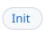

<!-- header # ffi "The FFI" | Engines #capabilities-by-engine | Command line #cli | State #statefulness | Language #language-engines | Data #data-engines | Asks #calls-from-a-recipe | Decorators #decorators | Reflection #reflection | Refs #references -->
<h1><a id="ffi"></a>The FFI<a href="#references"><picture><source media="(prefers-color-scheme: dark)" srcset="img/hdr/docs-ffi.ffi.8.dark.svg"></picture></a><a href="#reflection"><picture><source media="(prefers-color-scheme: dark)" srcset="img/hdr/docs-ffi.ffi.7.dark.svg"></picture></a><a href="#decorators"><picture><source media="(prefers-color-scheme: dark)" srcset="img/hdr/docs-ffi.ffi.6.dark.svg"></picture></a><a href="#calls-from-a-recipe"><picture><source media="(prefers-color-scheme: dark)" srcset="img/hdr/docs-ffi.ffi.5.dark.svg"></picture></a><a href="#data-engines"><picture><source media="(prefers-color-scheme: dark)" srcset="img/hdr/docs-ffi.ffi.4.dark.svg"></picture></a><a href="#language-engines"><picture><source media="(prefers-color-scheme: dark)" srcset="img/hdr/docs-ffi.ffi.3.dark.svg"></picture></a><a href="#statefulness"><picture><source media="(prefers-color-scheme: dark)" srcset="img/hdr/docs-ffi.ffi.2.dark.svg"></picture></a><a href="#cli"><picture><source media="(prefers-color-scheme: dark)" srcset="img/hdr/docs-ffi.ffi.1.dark.svg"></picture></a><a href="#capabilities-by-engine"><picture><source media="(prefers-color-scheme: dark)" srcset="img/hdr/docs-ffi.ffi.0.dark.svg"></picture></a><br clear="all"></h1>
<!-- /header -->

The several engines for `amk` come in a few primary flavors:

| Type | State | Reads / Calls | Engines |
| --- | --- | --- | --- |
| [Language Engines](#language-engines)  | namespaces | Guest program functions & declared variables | [lua](../README.md#lua), [s7](../README.md#s7), [micropy](../README.md#micropy), [js](../README.md#js), [wasm](../README.md#wasm) |
| [Data Engines](#data-engines)         | workspaces | Backend store (in-memory or disk); programs that filter or mutate it | jq, sqlite |
| Stateless Engines                     | none | Simple program I/O | [awk](../README.md#awk) |
| [Stacked Engines](#stacked-engines)   | none, or a guest's workspaces for the [data variety](#data-variety) | targets and functions its decorators write | amk, bash, [utmpl](docs/utmpl.md), [tspace](tspace.md) |

Each engine describes one guest.  Thus each engine *kind* must perform at least wrap-and-run services for some language (that's exactly the *minimum* description for a new guest), and each engine can also contribute new [decorator syntax](#decorators).  Past that, the major engine-variants, where some engines may have some *awareness* of what they are wrapping, or some ability to operate *on* it as well as *with* it.  Some kinds have a concept of saved-state, and some have a concept multiple scratchpads for that state, etc.

Data Engines are amk's main approach for building [datastructures](data-engines.md#data-engines).  For them *namespaces* are fairly opaque, but *workspaces* are more developed.  For example with jq.. jqlang-functions cannot be enumerated, but mutating the state those functions operate on is fast, easy, and cheap.

Stacked Engines are unique in that they are **not** linked or embedded, thus they require no cosmocc build and are potentially *user-space*.  These are made available as amk libraries or as modules, may be user-defined as part of [bundling](payloads.md#bundles) and [payloads](payloads.md#payloads), etc.  

<a id="capabilities-by-engine"></a>

## Capabilities by Engine

| Engine | Aliases | Command Line | `.argv` | State | Deadline |
| --- | --- | --- | --- | --- | --- |
| [awk](../README.md#awk) | `gawk` | yes | yes | - | unsupported |
| [wasm](../README.md#wasm) | `wasm3` | a module | yes | namespaces | `deadline ms` ahead of the call in `exec`; unsupported for a loop that calls nothing |
| [lua](../README.md#lua) | | yes | - | namespaces | `amk.deadline` |
| [s7](../README.md#s7) | `lisp` | yes | - | namespaces | `amk-deadline`; unsupported for a loop whose body is one form |
| [micropy](../README.md#micropy) | | yes | - | namespaces | `amk.deadline` |
| [js](../README.md#js) | | yes | - | namespaces | `amk.deadline` |
| [jq](../README.md#jq) | | yes | yes | workspaces | unsupported |
| [sqlite](../README.md#sqlite) | `sqlite3` | yes, sqlite's own shell | yes | workspaces | `--deadline ms` on `get` and `update` |

The rows live in `src/amk/amk_engine.c`. `amk --list-engines` reports the deadline column as `"deadline"`: `"handle"`, `"option"`, or `null`. At startup `amk_engines_check` refuses a row without a command line, with both kinds of state, or missing a required verb.

```Makefile
# each of these stops make, naming the engine and what it has
$(awk.ns.create w)           # awk has no namespaces or workspaces
x := $(sqlite.exec 1)        # sqlite has no such operation; one of get update load
$(lua.ns.create w)
y := $(w.get 1)              # lua has no such operation; one of exec import
```
<!-- 
<!-- header cli "The command line" | By value #pass-by-value | By reference #pass-by-reference | Flags #flags -->
<h2><a id="cli"></a>The command line<a href="#flags"><picture><source media="(prefers-color-scheme: dark)" srcset="img/hdr/docs-ffi.cli.2.dark.svg"></picture></a><a href="#pass-by-reference"><picture><source media="(prefers-color-scheme: dark)" srcset="img/hdr/docs-ffi.cli.1.dark.svg"></picture></a><a href="#pass-by-value"><picture><source media="(prefers-color-scheme: dark)" srcset="img/hdr/docs-ffi.cli.0.dark.svg"></picture></a><br clear="all"></h2>
<!-- /header -->

Every engine has one. It answers the builtin, an imported target's job, and the
multi-call names. -->

<a id="pass-by-value"></a>

### Pass by Value

| Form | Engines |
| --- | --- |
| `$(eng prog[, input])` | every engine; wasm takes a module and its arguments |
| `$(eng.argv argv, prog[, input])` | awk, wasm, jq, sqlite |
| `$(eng.target target, prog[, flags[: prereqs]])` | every engine but wasm |
| `@eng.target [flags][: prereqs]` above `define target` | every engine but wasm |
| `$(wasm.build toolchain, source)`, `@wasm.build(toolchain)` above `define source` | wasm, from the wasm library |

`eng.target` is short for `eng.import.target`, and every form takes either name. In
either form the text after the first unquoted colon in the flags is the target's
prerequisites, so `@jq.target --null-input : fetch` runs `fetch` first.

A call forks the engine's entry point, with two exceptions. A data engine with a
[`filter`](#data-engines) runs the plain form in the make process. A target of a language
engine with no flags is a fork of the parsed image, and it runs the program in `main`, the
state the module's `import` and `exec` calls left, with its output on the job's stdout.
The word `fresh` as the flags opts a target out, into the engine's entry point; so do the
engine's own options, which an imported target passes ahead of the program:

```Makefile
@js.import
define marks.js
  globalThis.marked = "set at parse";
endef

@js.target
define probe
  print(`target: ${typeof globalThis.marked}`);
endef

@js.target fresh
define alone
  print(`target: ${typeof globalThis.marked}`);
endef

@jq.target --null-input --compact-output
define jq.events
  {level: "info"}, {level: "error"}
endef

@sqlite.target -json
define sq.sum
  .import --csv /dev/stdin t
  SELECT sum(v) AS total FROM t;
endef
```

<a id="defining-a-target-in-an-engine"></a>

#### Defining a target in an engine

`eng.target` keeps the program as the variable `target` and makes `target` a rule
whose job runs it. Its output is the target's value, which another imported body
splices in as `>>target<<`; a plain recipe target's output is its value the same way, see
[values](dataflow.md#values). For a target written in make itself, see
[`@amk.target`](#decorators).

<a id="pass-by-reference"></a>

### Pass by Reference

Every builtin has a star form whose arguments may name variables.

| Form | Engines |
| --- | --- |
| `$(eng* program_var[, input_var])` | every engine |
| `$(eng.argv* argv, program_var[, input_var])` | awk, wasm, jq, sqlite |
| `$(eng.target* program_var[, flags])` | every engine but wasm |
| `$(eng.ns* name, op, program_var)` | language and data engines |
| `$(name.op* program_var)` | language and data engines |

<a id="load"></a>

### Load

Make's `load` directive takes a [module](../README.md#modules), one file for one engine,
instead of a shared object, and the file's extension picks the engine: every engine claims its own name and each of its aliases, so `.lua`,
`.js`, `.s7` and `.lisp`, `.micropy`, `.wasm` and `.wasm3`, `.jq`, and `.sqlite` and
`.sqlite3` are claimed in this build. A language engine imports the file's text into
`main`, so its functions are make functions on the next line; wasm imports the module at
that path; a data engine loads the file as the whole of its `main` state. Each loaded path
joins `.LOADED`, and `load` is in `.FEATURES`.

```Makefile
# twice.lua beside the makefile holds "function twice(x) return 2 * x end"
load ./twice.lua
answer := $(twice 21)

# state.jq holds a json document, now main's value
load ./state.jq
n := $(jq.get .a | length)

# the payload's own library for lua, and a walk for one file below it
load dkjson.lua
load .../dkjson.lua
```

Where the file is looked for follows the path's first characters, the way `include` and
`$(amk.include ...)` divide the work:

| Path | Looked for |
| --- | --- |
| `./x.lua`, `../x.lua` | at that path under the working directory |
| `/opt/x.lua` | at that absolute path; `/zip/...` reaches the payload by hand |
| `x.lua`, `sub/x.lua` | under each library root's folder for the engine in turn, `<root>/lua/`; the roots are the entries of `AMKPATH`, colon separated, then the payload's `/zip/lib` |

`AMKPATH` works as python's path does: each entry is laid out like `lib/`, with `<eng>/`,
`amk/` and `<name>/` folders, is searched ahead of the payload, and so shadows it; the
payload fallback and `amk.include` walk the same roots in the same order. `AMK_PATH` is
read when `AMKPATH` is unset.

One path component spelled `...` walks every depth below the directory before it, that
directory included, in sorted order: `./mods/.../x.lua` finds `./mods/a/b/x.lua`, and
`.../dkjson.lua` finds `/zip/lib/lua/dkjson.lua`. The walk must end at exactly one file.

When two engines claim one extension the first in the engine table wins, so cpython would
take `.py` ahead of micropy whenever it is built in. A loaded file is read at the parse and
never rebuilt. A user-defined engine, [registered](#stacked-engines) with `amk.engine`,
claims its name and aliases too, after every row: `load fib.zig` below `$(amk.engine zig,
guest=wasm)` is `@zig.import` over that file, the file's text under its basename; the same
line above the registration is an unclaimed extension.

A [payload](payloads.md#payloads) name no engine claims, `load amb` with no extension or
`load amb.scm` with an unclaimed one, gets one last search of the payload, which a
[bundle](payloads.md#bundles) extends with its own files, in this order, first match taken:

1. `/zip/lib/<eng>/amb.*` over the engine libraries, or exactly `amb.scm` when an
   extension was given; the directory names the engine, so `lib/s7/amb.scm` loads in s7.
   The match must be unique: a stem two engine libraries both hold stops make at the
   line, naming both files, under `-load` too.
2. whatever `$(amk.include amb)` would read, through `amk.include` itself: `/zip/lib/amk/amb.amk` or `amb.mk`,
   else `/zip/lib/amb/init.amk`, so a module's own makefile does its setup. `load` degrades to
   include exactly here, with include's guard, so a name already in `amk.included` is a no-op.

An engine file taken this way prints a warning at the line naming the path and the engine,
since the directory chose it; the include step is as quiet as `include`, being the intended
spelling. No hit prints the search order and stops make with `NoSuchModule: ENOENT`;
`-load` is silent instead. These warnings go
through `amk.warning`, which prints `file:line: text` on stderr like `$(warning ...)` but
honors `-s` and `--silent` as given on the command line or in the environment, not the
`-s` the prelude adds for recipes; it is a builtin too, `$(amk.warning text)`.

A `load` line is idempotent: a path already in `.LOADED` is not read again, silently. Every
line is still recorded, as written, in `amk.loaded`, the twin of `amk.included`, so that list
may repeat a name while `.LOADED` holds each path once.

A shared object, `load plugin.so` from a makefile written for stock make, stops make under
both forms with `PlatformError: ENOSYS`: amk is portable through cosmocc and never dlopens.

A missing file, or a file that does not import, stops make at the line under `load` and is
silent under `-load`. The errors of the line itself stop make under both: an extension no
engine claims, named with the extensions that are, a `...` walk that matches more than one
file, two `...` components, and a file whose stem is `init`, since a module's init has
[other semantics](payloads.md#modules).

<a id="flags"></a>

### Flags

| Form | Does |
| --- | --- |
| `amk --eng args...`, or the binary under an engine's name | runs that engine's command line |
| an alias, such as `lisp` for s7 | every form under that name too: `$(lisp ...)`, `$(lisp.exec ...)`, `@lisp.import`, `amk --lisp`, and the binary named `lisp`, all in the same engine and state |
| `amk --eng -` | reads the program from standard input |
| `amk --list-engines` | every engine as JSON, with its capabilities read from the build |

`amk --sqlite` is sqlite's own shell. After `--`, its database is in memory unless one
was named before it, and each argument may mix statements with dot commands.

<!-- header statefulness "Statefulness" | Persistent state #persistent-state | Who reaches it #who-reaches-the-state -->
<h2><a id="statefulness"></a>Statefulness<a href="#who-reaches-the-state"><picture><source media="(prefers-color-scheme: dark)" srcset="img/hdr/docs-ffi.statefulness.1.dark.svg"></picture></a><a href="#persistent-state"><picture><source media="(prefers-color-scheme: dark)" srcset="img/hdr/docs-ffi.statefulness.0.dark.svg"></picture></a><br clear="all"></h2>
<!-- /header -->

A namespace and a workspace are both named state, held by one engine for the life of the
make process. They are made and reached by the same forms, so `name` below is either one.
Every language and data engine has `main`; `create` makes another, with a handle per
operation.

| Form | Does |
| --- | --- |
| `$(eng.ns.create name)`, `$(eng.ns name, create)` | makes `name` and its handles |
| `$(eng.ns name, op, prog)` | runs the operation in `name` |
| `$(name.op prog)` | the same, through the handle |
| `$(eng.op prog)` | the operation in `main` |

A handle exists for each operation of the engine's type, and no other: a name outside the
interface, such as `w.exec` on a jq workspace, stays free for a library to define with
`amk.fxn!`. A name belongs to the engine that created it, and another engine's `create` of
it fails.

<a id="persistent-state"></a>

### Persistent state

What one call leaves in a namespace or workspace, the next call finds:

```Makefile
$(lua.ns.create work)
$(work.exec x = 41)
answer := $(work.exec print(x + 1))
```

<a id="who-reaches-the-state"></a>

### Who reaches the state

The state belongs to the make process, not to the engine's guests, so every caller reaches
the same one:

| Caller | How |
| --- | --- |
| a makefile | the handles, `$(name.op prog)`, or `$(eng.ns name, op, prog)` |
| a language engine's guest | its handle's [ask](#guest-handle), such as `amk.ask("update", "w", prog)` in lua |
| a recipe | a request on `AMK_ASK`, or `amk.ns` from `amk.sh`; see [asks from a recipe](#calls-from-a-recipe) |
| a sub-make | forwards its workspace ops to its caller, so a run has one set of workspaces; its namespaces are its own |

A guest of one engine can keep its data in another engine's workspace, and two guests that
share one talk without the host in the middle.

<a id="failures"></a>

### Failures

A call that fails stops make at the expansion, after the engine's own message, whichever
form made it: a one-shot call, `.argv`, `exec`, `import`, a workspace operation, or a
function a guest defined. A raise in such a function is a failure too; returning nothing is
not.

```
f.mk:1: *** lua: lua exited with status 1.  Stop.
f.mk:2: *** w.exec: lua exec exited with status 1.  Stop.
```

Through `amk.call` the caller raises with that message instead, and through `amk.acall`
the promise rejects. A recipe's `amk.ask` answers the status. A status the engine answers
with is not a failure: jq's `-e`, and an expired deadline, which answers empty
([deadlines](runtime.md#deadlines), [data engines](data-engines.md#failures)).

<a id="namespaces"></a>
<a id="state-interface"></a>

<!-- header language-engines "Language engines" | Init #init | Hooks #hooks | Guest handle #guest-handle | Host handle #host-handle | Deadlines #deadlines | Functions #registering-make-functions -->
<h2><a id="language-engines"></a>Language engines<a href="#registering-make-functions"><picture><source media="(prefers-color-scheme: dark)" srcset="img/hdr/docs-ffi.language-engines.5.dark.svg"></picture></a><a href="#deadlines"><picture><source media="(prefers-color-scheme: dark)" srcset="img/hdr/docs-ffi.language-engines.4.dark.svg"></picture></a><a href="#host-handle"><picture><source media="(prefers-color-scheme: dark)" srcset="img/hdr/docs-ffi.language-engines.3.dark.svg"></picture></a><a href="#guest-handle"><picture><source media="(prefers-color-scheme: dark)" srcset="img/hdr/docs-ffi.language-engines.2.dark.svg"></picture></a><a href="#hooks"><picture><source media="(prefers-color-scheme: dark)" srcset="img/hdr/docs-ffi.language-engines.1.dark.svg"></picture></a><a href="#init"><picture><source media="(prefers-color-scheme: dark)" srcset="img/hdr/docs-ffi.language-engines.0.dark.svg"></picture></a><br clear="all"></h2>
<!-- /header -->

A language engine's state is a namespace: code run in it defines functions and variables,
and `import` lifts them into make, one make function per guest function.

| Verb | Does |
| --- | --- |
| `create` | a fresh namespace |
| `exec` | runs code in the namespace, its output at the call's place |
| `import` | runs code, then lifts the functions and variables it defined into make; [`load`](#load) does the same from a [module](../README.md#modules) file |
| `hook`, optional | hears every [event](#hooks) in `main` |

`$(eng.import prog)` and `@eng.import` above a define both run in `main`; the define's
name is only a carrier for its body. micropython has one heap, so it has `main` only.

For wasm the program is not text. `import` takes a module, a path or its bytes in hex,
loads it into the namespace's runtime and lifts every export make can spell; `exec` takes
`[deadline ms] name [args...]` and calls one export, and given a module instead it imports
it, which is how an init chunk names one. [docs/wasm.md](wasm.md) shows the forms, the
handle a module imports under `amk`, and the library that builds a module from source.

<a id="init"></a>

### Init

Before the parse, each language engine runs one chunk in `main`, its output on stderr. The
chunk is `AMK_<ENGINE>_INIT`, as text or as `@path`; without it, the payload's
`__init__.<engine>`.

<a id="hooks"></a>

### Hooks

A namespace's `hook` hears `goals`, `recipe_start` and `recipe_end` in `main`. Each guest
subscribes through its handle:

```Makefile
$(lua.exec amk.on.goals = function(e) io.stderr:write("goals\n") end)
```

<a id="guest-handle"></a>

### Guest Handle

| | lua | micropy | s7 | js |
| --- | --- | --- | --- | --- |
| read | `amk.var.var1`, `amk.var["a.b"]` | `amk.var.var1`, `amk.var["a.b"]` | `(amk-var 'var1)`, `(amk-var "a.b")` | `amk.var.var1`, `amk.var["a.b"]` |
| write | `amk.var.var1 = "value1"` | `amk.var.var1 = "value1"` | `(set! (amk-var 'var1) "value1")` | `amk.var.var1 = "value1"` |
| read raw | `amk.var.raw.var1` | `amk.var.raw.var1` | `((amk-var 'raw) 'var1)` | `amk.var.raw.var1` |
| write raw | `amk.var.raw.var1 = "$(var2)"` | `amk.var.raw.var1 = "$(var2)"` | `(set! ((amk-var 'raw) 'var1) "$(var2)")` | `amk.var.raw.var1 = "$(var2)"` |
| expand | `amk.expand(text)` | `amk.expand(text)` | `(amk-expand text)` | `amk.expand(text)` |
| eval | `amk.eval(text)` | `amk.eval(text)` | `(amk-eval text)` | `amk.eval(text)` |
| call | `amk.call(name, ...)` | `amk.call(name, *values)` | `(amk-call 'name value ...)` | `amk.call(name, ...values)` |
| call one layer | `amk.fxn(name, ...)`, `amk.macro(name, ...)` | `amk.fxn(name, *values)`, `amk.macro(name, *values)` | `(amk-fxn 'name value ...)`, `(amk-macro 'name value ...)` | `amk.fxn(name, ...values)`, `amk.macro(name, ...values)` |
| call by attribute | `amk.sys("pid")`, `amk.pool.acquire("m")` | `amk.sys("pid")`, `amk.pool.acquire("m")` | `(amk-sys "pid")`, `(amk-pool-acquire "m")` | `amk.sys("pid")`, `amk.pool.acquire("m")` |
| acall | `amk.acall(name, ...)`, a handle with `pid`, `fd`, and `result()` | `await amk.acall(name, *values)` | `(amk-call-begin 'name value ...)` answers `(pid fd)`, `(amk-call-end pid)` collects | `await amk.acall(name, ...values)` |
| acall one layer | `amk.afxn`, `amk.amacro`, the same handle | `await amk.afxn(...)`, `await amk.amacro(...)` | `(amk-afxn ...)`, `(amk-amacro ...)` answer `(pid fd)` | `await amk.afxn(...)`, `await amk.amacro(...)` |
| ask whether a name answers | `amk["call?"](name)`, `amk["fxn?"]`, `amk["macro?"]`, `amk["goal?"]`, each `"1"` or `""` | `getattr(amk, "call?")(name)` and the other three | `(amk-call? name)`, `(amk-fxn? name)`, `(amk-macro? name)`, `(amk-goal? name)` | `amk["call?"](name)` and the other three |
| ask | `amk.ask(op, namespace, ...)`, a handle with `id` and `result()` that waits | `amk.ask(op, namespace, *values)`, a handle with `id` and `result()` that waits | `(amk-ask-begin 'op namespace value ...)` answers the id, `(amk-ask-end id)` waits | `await amk.ask(op, namespace, ...values)`, settled by the reply while the loop runs |
| define a function | `amk.func(name, fn)` | `amk.func(name, fn)` | `(amk-func 'name fn)` | `amk.func(name, fn)` |
| events | `amk.on[event]` | `amk.on[event]` | `(amk-on 'event)` | `amk.on[event]` |
| deadline | `amk.deadline(ms, fn, ...)` | `amk.deadline(ms, fn, *args)` | `(amk-deadline ms fn arg ...)` | `amk.deadline(ms, fn, ...args)` |
| undefined | `nil` | `None` | `#f` | `undefined` |

A raw read returns the text as stored, never expanded, and a raw write defines a recursive
variable, as a define does; `amk.var` expands on read and stores its value literally.

`amk.call` resolves its name by one cascade in every guest: the name itself, then the name
under `amk.`; either spelling as a make function first, run as `$(name ...)`, else as a
macro, run as `$(call name, ...)`. A promoted define is both at once and counts once. A
name both spellings answer is refused, with both named, and `amk.fxn` or `amk.macro` picks
one by its full name. A handle attribute the handle lacks, `amk.sys`,
`amk.pool.acquire`, `amk.goal`, is the same cascade on that name after the module check of
[modules](payloads.md#modules), so a dotted attribute chains the dots into the name. The
predicates are make builtins, `$(amk.call? name)`, `$(amk.fxn? name)`, `$(amk.macro? name)`
and `$(amk.goal? name)`, each `1` or nothing, and a guest reaches them as it reaches any
`amk.` function. Registration is `$(amk.fxn! name)`; the bang marks the one form that
defines rather than calls.

```Makefile
var1 := value1
flags = -O2 $(EXTRA)

# reads and expansion, from a one-shot call: value1, -O2, and 3
seen := $(lua print(amk.var.var1, amk.expand("$$(strip $$(flags))"), amk.expand("$$(words a b c)")))

# a write from a one-shot call lands once the call returns, so the next line sees it
$(micropy import amk; amk.var.EXTRA = "-g"; amk.eval("debug: ; @echo $$(flags)"))
now := $(flags)
```

```Makefile
pair = [$1|$2]

# [x,y|$(shell id)], with nothing run: both values arrive whole
both := $(micropy import amk; print(amk.call("pair", "x,y", "$$(shell id)")))

# a;b, from the builtin with a comma in a value
swapped := $(lua print(amk.call("subst", ",", ";", "a,b")))

# the same two calls as fields of the handle: a missing field that names a builtin is it
pid := $(lua print(amk.sys("pid"), amk.pool.size("goals")))

# a pool's verbs are bound under its own name once it is open
$(amk.pool door, 1)
got := $(lua print(amk.pool.door.acquire("0"), amk.pool.door.held()))
```

A field `amk` lacks is looked up twice: first as a topic, `lib/<name>/`, then as the make
function `amk.<name>`, which answers as a callable whose own fields reach
`amk.<name>.<field>` the same way. A topic wins when both exist, and a name make lacks
stays missing. In s7 the spelling is `amk-<name>-<field>`, dashes for dots, through the
same unbound-variable hook that loads a topic.

An ask is one request line on the ask channel, the same `op namespace program` a recipe
writes to `AMK_ASK`, and costs no process: the request goes up at once and the guest runs
on until it collects the reply. In the owner, where nothing is up the channel, the request
is answered in place, and one that would park there is refused with
`the operation parked, and the owner would wait on itself`. Only js holds many waiting asks
at once, since only js has an event loop; the others wait where they collect. An ask is
how a guest reaches a [workspace](data-engines.md#made-on-first-use).

<a id="host-handle"></a>

### Host Handle

The calls above reach make's language: its variables, functions, and rules. The calls
here reach the host process instead: its child jobs, its terminal, and its exit status.

Job control is make functions, so a makefile, a recipe, and every guest call the same
ones: `$(amk.kill $(pid))` in a makefile, `amk.kill(pid)` in lua, micropy and js through
the handle's fallback to make functions, `(amk-kill pid)` in s7. Each takes text and
answers text, the same from every caller. A guest that wants native values uses the
[jobman](jobman.md) of `lib/jobman` instead, which wraps these.

| Function | Does |
| --- | --- |
| `$(amk.spawn goals[, foreground=1][, stdout=path])` | forks this parsed image to run the goals, a word list of one to sixty-three, as its own process group; answers the pid |
| `$(amk.spawn.argv argv[, foreground=1][, stdout=path])` | the same, with the list split as a shell would, as `eng.argv` splits, so `'NAME=a b'` reaches the job as one command-line assignment |
| `$(amk.wait [pids[, block]])` | collects the next finished or stopped job, or the first of the pids named, as a json object, and never reaps a job outside the pids named; with `block` empty, `0` or `false`, empty when none has; with `block` `peek`, the same without blocking and the record left for the next wait; empty when no job it could wait for is live |
| `$(amk.kill pid[, sig])` | sends `sig`, by default terminate, to the job and every shell under it; `1`, or empty for a pid that is not a live job of this process |
| `$(amk.stop pid)` | stops the job; `1`, or empty as for kill |
| `$(amk.resume pid)` | continues the job and leaves the terminal where it is; `1`, or empty as for kill |
| `$(amk.foreground pid)` | hands the job the terminal, then continues it; `1`, or empty as for kill |

A pid or signal that is not a number, or a spawn of no goals, fails naming the function: a
guest catches it through `amk.call`, and at a plain expansion it is fatal. These act on
jobs of this process only, so a fork that calls them reaches its own jobs, not its parent's.
The names are reserved: a makefile function named `kill` or `wait` makes the bare guest
spelling `amk.kill` ambiguous, so call it by its full name with `amk.fxn` then.

The guests keep three calls of their own:

| Call | Does |
| --- | --- |
| `amk.send(text)` | from inside a job, writes text to the parent's mail for that job; false outside a job |
| `amk.exit_code(n)` | lua only: the status this process leaves with, whatever make's own turns out to be |
| `amk.exited(pid)` | js only: a promise for the job's `amk.wait` result once it finishes |
| `amk.goal(name)` | the make function `goal` under the handle's name: the goal brought up to date by a fork, its value answered; every guest, through the handle's fallback to make functions. A goal that fails raises in the caller, so a guest may try another; at a plain expansion it is fatal. Name a target after its rule or define, since an earlier call sees no target |
| `amk.agoal(name)` | `amk.acall` of the same, so the goal runs while the caller goes on: a handle in lua, an awaitable in micropy, a promise in js, `(pid fd)` from `(amk-agoal name)` in s7 |

`foreground=1` hands the new job the terminal as it starts, and `stdout=path` names a file
that takes its output. The job is a fork, so it sees the parse and every guest state as
they stood at the spawn; a fatal signal at the parent ends the job and its shells, and a
normal exit sweeps a job still running.

`amk.wait` answers one json object with `pid`, `code`, `signal`, `status`, `mail` and
`kind`, which is `goals`, `goal` or `call`. A call's record also has `"value": true` while
its value is still to be read: the record never holds the value itself, which may be any
size. `$(amk.job.value pid)` reads it to its end and takes it, once, and leaves the job for
its wait; `$(amk.call.spawn name, args...)` is the call that makes one, and a guest's
`amk.acall` is the same call with the value streamed through its handle.
`status` is `success`, `question` for make's exit 1, `failed` for any other code,
`signal`, or `stopped`. A stopped job's `mail` is empty; its mail arrives with the result
that finishes it.

```Makefile
all:
	@echo 'pid=$(eval p := $(amk.spawn two))$(p) rec=$(amk.wait $(p))'
two:
	@exit 3
# pid=4242 rec={"pid": 4242, "code": 2, "signal": 0, "status": "failed", "mail": "", "kind": "goals"}
```

From a guest, the answer is decoded with that guest's own json, or the pool handle does it:

```Makefile
seed := $(lua.exec)
all:
	@echo $(lua.exec local json = require('dkjson') local r = json.decode(amk.wait(amk.spawn('two'))) print(r.status, r.code))
```

Every job has a pipe to its parent. A recipe writes it through the descriptor `AMK_MAIL`
names, the job's own guest writes it with `amk.send`, and the parent reads the whole of
it as `mail` on the wait result, in the order the writes landed. A silent job mails the
empty string, and one job's writers never see another's mail.

```Makefile
talker:
	@printf 'one ' >&$$AMK_MAIL
	@true $(lua.exec amk.send('two '))
# mail=[two one ], since the recipe expands before its lines run
all:
	@echo mail=[$(lua.exec local p = amk.spawn('talker') print(require('dkjson').decode(amk.wait(p)).mail))]
```

`amk.kill` passes `sig` through as the host's number, and stop and continue differ between
hosts, so use `amk.stop` and `amk.resume` for those. `amk.wait` reports a job stopped by
`amk.stop` as `status: "stopped"`, the same as one the terminal stopped, so a scheduler
keeps track of the stops it sent itself. Under a terminal, a background job that reads it
stops, and `amk.foreground` is what lets it go on, as a shell's `fg` does; a job under a
served request is in [the zygote](zygote.md#foreground-jobs-under-a-served-request).

`amk.exited(pid)`, js only, is the one job call that stays in a guest, since it needs the
event loop: a promise for the job's wait result as an object, once it finishes. It lets an
event loop keep running while a job does. While any pid is awaited,
the loop also answers the jobs' own calls into make, such as a store request, which
otherwise wait for a blocking `amk.wait`. A stop does not settle the promise, and a pid
that is not a live job of this process rejects it. The `goal` kind of an actor group is a
spawn awaited this way; see [the actor module](actor.md#kinds).

```js
const r = await amk.exited(Number(amk.spawn("test")));
print(r.status, r.code);
```

`amk.exit_code` is for a guest that runs the whole program, such as a loop under a recipe,
and wants its own status past make's exit 2 for a failed goal.

<a id="deadlines"></a>

### Deadlines

`amk.deadline(ms, fn, ...)` bounds a call in wall-clock time across every guest; it is
covered in [the runtime's deadlines](runtime.md#deadlines).

<a id="registering-make-functions"></a>

### Registering make functions

A function a guest defines with `amk.func`, or one `import` lifts, becomes a make
function that answers in the namespace that defined it:

```Makefile
@lua.import
define lua.methods
  function add(a, b) return a + b end
endef

@js.import
define js.methods
  function shout(s) { return s + "!"; }
endef

sum := $(add 1,2)
loud := $(shout hi)
```

A function that raises fails the call that made it, with a message naming the engine and
the function, such as `lua $(add ...): attempt to perform arithmetic`. Through make the
run stops at the expansion; through `amk.call` the caller raises; through `amk.acall` the
promise rejects, or the handle's `result()` raises. A function that returns nothing, `nil`,
`None`, `undefined` or no value, answers empty and succeeds.

<a id="workspace-interface"></a>

<!-- header data-engines "Data engines" | Backings data-engines.md#backings | jq data-engines.md#jq-workspaces | sqlite data-engines.md#sqlite-workspaces -->
<h2><a id="data-engines"></a>Data engines<a href="data-engines.md#sqlite-workspaces"><picture><source media="(prefers-color-scheme: dark)" srcset="img/hdr/docs-ffi.data-engines.2.dark.svg"></picture></a><a href="data-engines.md#jq-workspaces"><picture><source media="(prefers-color-scheme: dark)" srcset="img/hdr/docs-ffi.data-engines.1.dark.svg"></picture></a><a href="data-engines.md#backings"><picture><source media="(prefers-color-scheme: dark)" srcset="img/hdr/docs-ffi.data-engines.0.dark.svg"></picture></a><br clear="all"></h2>
<!-- /header -->

A data engine's state is a workspace: a jq value or a sqlite database. Programs read it
and change it through a fixed set of verbs, and nothing in it becomes a make function.

| Verb | Does |
| --- | --- |
| `create` | a fresh, empty workspace |
| `get` | runs a program over the workspace and prints its output; the workspace is left as it was |
| `update` | runs a program that may change the workspace |
| `load` | replaces the whole workspace with a text, all or nothing |
| `dump` | prints the whole workspace as the text `load` takes back |
| `filter`, optional | runs a program over an input text, with no workspace |
| `open`, optional | makes a backing file the store itself, instead of loading and writing it |

Every output is a sequence of lines, which the ask channel counts. The verbs are a
contract on the engine row, `struct amk_workspace_ops` in `src/amk/amk.h`.
[Data engines](data-engines.md) covers seeding a workspace with `import`, keeping it in a
file with a backing, workspaces made on first use, and each engine's verbs.

<a id="calls-from-a-recipe"></a>

## Asks from a recipe

A recipe asks the make process for an op on any namespace or workspace through a
descriptor pair, `AMK_ASK` for requests and `AMK_REPLY` for answers. A request is one line,
`op name program`; the reply is `status count`, then `count` lines of output. A sub-make
forwards its workspace ops to its caller's pair, so a run has one set of workspaces.

| Request | Does |
| --- | --- |
| `get name prog`, `update name prog` | the op in a workspace, made on first use |
| `exec name prog`, `import name prog` | the op in a namespace, in the owner's state |
| `create name run`, `create name owned path`, `create name shared path` | declares the workspace's backing |
| `load name path` | loads the file's text |
| `dump name` | prints the whole workspace |
| `filter engine count prog` | the engine's `filter`, over the `count` lines after the request; an engine without one is refused by name |
| `halt` | no more recipe lines or goals; make exits 112 |

`source amk.sh` in a recipe gives shell helpers over the pair:

| Helper | Does |
| --- | --- |
| `amk.ask 'line' [input...]` | one request; prints the output, returns the status |
| `amk.ns op name [options] -- prog` | one operation, a bound value quoted for the line |
| `amk.words args...` | quotes words for a request line |
| `amk.filter engine [options] prog` | `filter` over standard input, in the named engine |
| `jq.pipe [options] prog` | `amk.filter jq` |

```Makefile
SHELL := bash
$(sqlite.ns.create D)
count:
	@source amk.sh; amk.ns update D -- 'CREATE TABLE t(k); INSERT INTO t VALUES(1)'
	@source amk.sh; amk.ns get D -- 'SELECT count(*) AS n FROM t'
```

<a id="decorators"></a>

## Decorators

A decorator is a column-0 `@name` line above a `define`. The preprocessor parses its
arguments once, with one grammar for every name, and calls the macro `name_star` with the
define's name and the arguments as written:

```
@name [word | "quoted literal"]... [(positional, group)] [{key=value ...}] [: prereqs] [::: mark]
```

Positional arguments are bare words or a parenthesized group, in order; the group also
takes commas, and a quoted literal keeps its spaces. Options are `key=value` inside
braces, the callform shape. An unquoted colon starts the prerequisites. A group of each
kind at most, none nested, and a brace entry without a key is refused with the line. The
macro reads the pieces from variables set just before it is called:

| Variable | Holds |
| --- | --- |
| `amk.decorator` | `file:line: @name args`, the line as written |
| `amk.decorator.argc`, `amk.decorator.<n>`, `amk.decorator.<n>.key` | the positional elements, numbered from 1, and the key when one is written `name=value`, as a tuple space's fields are |
| `amk.decorator.kws`, `amk.decorator.kw.<key>` | the options' keys, and each key's value |
| `amk.decorator.deps` | the text after the colon |

A macro reads `<n>` up to `argc` and `kw.<key>` for keys in `kws`; the others may hold an
earlier decorator's values. `--preprocessor` prints the calls.

`@amk.target[{join=&&|;|none}] [: prereqs]` is the make-side decorator, a target as amk
writes one, and `@bash.target` its raw-shell sibling with no make dollars. It is a rewrite the
preprocessor does in place: the define stays, and after it comes a phony rule whose recipe
is the body, with make's own dollars, dedented and joined into one shell so a variable set
on one line is there on the next and the first failure stops the rest. Blank lines and
comments cost no shell, a leading `@#` block stays as the docstring, and a line that
already ends in a backslash or a shell operator is left as it is. The recipe opens with
the variable `<name>.preamble` when one is defined, which is how a library puts text
ahead of the body: a decorator whose name ends in `.amk`, such as a tuple space's
`@shop.amk`, is the same rewrite plus the library's own hook, which sets that variable.
`--preprocessor` prints the rule.

<a id="stacked-engines"></a>

## Stacked Engines

A stacked engine is a library that provides decorators under an engine-like name, with a
`<name>.__version__` so another library can find it, and no row: it has no builtin, no
multi-call name, and no `--list-engines` entry.

<dl>
<dt><strong><code>amklang</code></strong>, make itself</dt>
<dd>
<p><code>$(amklang prog)</code>, <code>$(amklang.exec prog)</code> and <code>$(amklang.argv argv, prog)</code> evaluate the program in a fork of this make, then run argv as its command line, and answer what it printed; its writes never reach this make. <code>@amklang.exec</code> and <code>@amklang.argv argv</code> over a define do the same at parse time and print it.</p>
<p><strong>Target:</strong> <code>@amk.target</code>, or <code>@amklang.target</code> or <code>@amklang.import.target</code>: a recipe with make dollars, joined.<br/>
<strong>Function:</strong> <code>@amklang.import</code>: the define's body dedented, preprocessed, and evaluated as makefile text; <code>@amk.fxn!</code> for one function.<br/>
<strong>Handler:</strong> <code>@&lt;space&gt;.bind.amk</code>.<br/>
<strong>Source:</strong> the prelude and the preprocessor.</p>
</dd>

<dt><strong><code>bash</code></strong>, on lua</dt>
<dd>
<p><strong>Target:</strong> <code>@bash.target</code>: a shell program with no make dollars, run by lua.<br/>
<strong>Function:</strong> none. <strong>Handler:</strong> none.<br/>
<strong>Source:</strong> <a href="../payload/lib/amk/bash.amk">bash.amk</a>.</p>
</dd>

<dt><strong><code>utmpl</code></strong>, on micropy</dt>
<dd>
<p><strong>Target:</strong> <code>@utmpl.target</code>.<br/>
<strong>Function:</strong> <code>@utmpl.import</code>.<br/>
<strong>Handler:</strong> none.<br/>
<strong>Source:</strong> <a href="../payload/lib/amk/utmpl.amk">utmpl.amk</a>; see <a href="utmpl.md">utmpl</a>.</p>
</dd>

<dt><strong><code>tspace</code></strong>, the data variety, on sqlite</dt>
<dd>
<p><strong>Target:</strong> <code>@tspace.target</code>: the define run as SQL on the default space; <code>@&lt;space&gt;.&lt;engine&gt;.target</code>: a guest target with the space bound.<br/>
<strong>Function:</strong> <code>@tspace</code>: a space created and seeded from the define's json; <code>@&lt;space&gt;.&lt;engine&gt;</code>: a guest import with the space bound.<br/>
<strong>Handler:</strong> <code>@&lt;space&gt;.bind.&lt;engine&gt;</code>.<br/>
<strong>Source:</strong> <a href="../payload/lib/tspace/init.amk">init.amk</a>; see <a href="tspace.md">the tuple space</a>.</p>
</dd>

<dt><strong><code>petri</code>, <code>workflow</code>, <code>kahn</code>, <code>fsm</code></strong>, the data variety, on jq</dt>
<dd>
<p><strong>Target:</strong> <code>@petri.target</code> and each form's: the define as the model, and a phony target of its name running <code>&lt;name&gt;.__main__</code>.<br/>
<strong>Function:</strong> <code>@petri</code> and each form's: the model from the define's json, or from scxml under <code>@fsm</code>; <code>@&lt;form&gt;.import</code>: the same from a file, PNML under <code>@petri.import</code>; <code>@&lt;form&gt;.exec (name)</code>: a jq program over the net, printed at parse.<br/>
<strong>Handler:</strong> none.<br/>
<strong>Source:</strong> <a href="../payload/lib/dsys/petri.amk">petri.amk</a> and the forms beside it; see <a href="petri.md">petri</a>, <a href="workflow.md">workflow</a>, <a href="kahn.md">kahn</a> and <a href="fsm.md">fsm</a>.</p>
</dd>

<dt><strong>A wasm toolchain</strong>: <code>zig</code>, <code>wat</code>, <code>golang</code>, or any name registered with <code>guest=wasm</code></dt>
<dd>
<p><strong>Target:</strong> <code>@name.target</code>: the module run as a wasi program.<br/>
<strong>Function:</strong> <code>@name.import</code>: the module's exports.<br/>
<strong>Handler:</strong> none.<br/>
<strong>Source:</strong> <a href="../payload/lib/amk/wasm.mk">wasm.mk</a>; see <a href="wasm.md#engine-api">the library</a>.</p>
</dd>
</dl>

A library registers its engine once, after its definitions, with the row's fields as
keywords and the engine it runs on as `guest`:

```Makefile
$(amk.engine utmpl, guest=micropy)
$(amk.engine zig, guest=wasm, aliases=zig, jit.env=Dockerfile.zig, jit.build=zig.build)
```

| Key | Field |
| --- | --- |
| `guest` | required; the row the engine runs on, or `amk` for make itself; its namespace semantics are the guest's |
| `aliases` | the other names it answers to; with the name, the extensions `load` routes to it, refused when a row or another engine holds one |
| `language`, `implementation`, `version`, `deadline` | the row's fields, the guest's by default; `version` becomes `name.__version__` unless the library set it |
| `jit.env`, `jit.build` | for a guest that imports modules, wasm: the Dockerfile define, optional, and the compile command define over `$<` and `$@`; `Dockerfile.name` and `name.build` by default when those exist |

The decorator form is the same registration over a define named after the engine whose
body is the row as a json object, the keys the same, read by the jq engine; a value is a
word or words, never a comma:

```Makefile
@amk.engine.spec
define golang
  {"guest": "wasm", "aliases": "go", "language": "Go", "implementation": "tinygo"}
endef
```

The row lands as `amk.engine.name.field`, the name in `amk.engines`, and each extension in
`amk.engine.ext.ext`, which is what `load` reads after the rows say no. An unknown key, a
missing or unknown guest, `jit` on a text-importing guest, or a wasm guest with no command
stops make at the line. A library without `@name.target` or `@name.import.target` stops make
there, and each interface form it leaves out stops make when used, with
`stacked engine name does not define form`.

<a id="data-variety"></a>

### The Data Variety

A stacked engine that defines `name.create`, `name.version` and `name.wait` is of the data
variety: registration detects the three functions and adds the name to `amk.data.engines`.
Its stores are its guest's workspaces, so it keeps the guest's [backings](data-engines.md#backings).

```Makefile
$(amk.engine tspace, guest=sqlite)
$(info $(amk.data.engines))     # tspace
```

The dsys forms are of this variety on jq: `petri`, `workflow`, `kahn` and `fsm` each keep
their model in a jq workspace, so `<name>.version` moves when the model changes and
`<form>.wait` waits past one.

<a id="reflection"></a>

## Reflection

| Variable | Holds |
| --- | --- |
| `.FEATURES`, `.ENGINES` | amk's features, and the engines in this build |
| `.AMK_VERSION`, `<engine>.__version__` | amk's version, and each engine's |
| `<engine>.__fxns__`, `<engine>.__vars__` | the functions and variables that engine gave make |
| `amk.__fxns__`, `amk.__vars__` | the same for every engine |

```Makefile
# the functions lua and js gave make, either way
methods := $(amk.fxns? lua, js)
methods := $(amk.fxns? lua js)
```

<a id="reference"></a>

## Reference

Where each part of the FFI lives. Modules are under `src/amk/`; a hook patch is under
`patches/` and holds the code that must read one of make's own statics.

| Form | Module |
| --- | --- |
| the engine rows, `amk_engines_check`, `$(eng ...)`, `.argv`, init, hooks | `amk_engine.c` |
| namespaces, workspaces, handles, workspace verbs, backings, `import`, the refusals | `amk_workspace.c` |
| `$(eng.target ...)`, `$(eng.import.target ...)` | `amk_workspace.c`, with its rule in `0013-read.patch` and its job in `0007-job.patch` |
| registering the builtins, the star forms | `0006-function.patch` |
| `@builtin` above `define`, the prelude, `AMK_NO_PRELUDE` | `0013-read.patch` |
| `>>name<<` in an imported body, the value policy, `.AMK_FILE`, `.AMK_NOCACHE`, a recipe value's output | `amk_goal.c`, with its job sites in `0007-job.patch` and `0002-commands.patch` |
| `@amk.file`, `@amk.nocache`, the mark kind | `payload/lang/amk/comp/targetdecorators.awk`, `payload/__init__.mk` |
| `$(amk.mode ...)`, the mode table, `amk.` settings | `amk_mode.c`, with its event sites in `0014-mode.patch` |
| the `dataflow` mode, `amk.dataflow_dir` | `amk_dataflow.c` |
| the guest handle, `$(amk.goal name)`, `$(amk.goal.maybe name)`, `$(amk.stdin text)` | `amk_guest.c` |
| `AMK_ASK`, `AMK_REPLY`, forwarding, `halt` | `amk_chan.c` |
| the host handle: `$(amk.spawn ...)`, `$(amk.wait ...)`, `$(amk.kill ...)`, `$(amk.stop ...)`, `$(amk.resume ...)`, `$(amk.foreground ...)`, `amk.send`, `amk.exit_code`, `AMK_MAIL` | `amk_spawn.c` for the job functions, registered by `amk_spawn_init`; `amk.send` and `amk.exit_code` in `guest/<engine>_main.c`, and js's `amk.exited` in its prelude there |
| `--serve`, `--client` | `amk_serve.c` |
| `--bundle`, `--ape-unpack`, `--ape-list` | `amk_payload.c` |
| a decorator above a define, `--preprocessor`, `AMK_DISABLE_PREPROCESS`, the `_star` macro a decorator calls | `payload/lang/amk/comp/definedecorators.awk`, `amk_preprocess.c`, `amk_engine.c` |
| the grammar symbols and the functions every amk awk program shares, `amk_die` and `joinlines` among them | `payload/lang/amk/awklib/globals.awk`, `payload/lang/amk/awklib/functions.awk` |
| `@amk.target`, its join kinds, the docstring block | `payload/lang/amk/comp/definedecorators.awk`, `payload/lang/amk/awklib/joinbody.awk` |
| multi-call names, `--list-engines`, `--version`, `--help`, `__main__` | `0010-main.patch`, `amk_engine.c` |
| `$(amk.require ...)`, `$(amk.sys ...)`, `$(amk.dedent ...)`, `$(cksum ...)`, `$(re.match ...)`, `$(amk.kwarg ...)` | `amk_builtins.c` |
| `$(amk.fxns? ...)`, `$(amk.vars? ...)` | `amk_engine.c` |
| `load`, `-load`, the extensions the rows claim, `.LOADED`, `amk.loaded`, `AMKPATH` | `amk_ns.c`, `amk_engine.c`, with its hook in `0009-load.patch` and the shared lookup `amk.lib.path` over `amk.lib.roots` in `payload/__init__.mk` |
| `$(amk.warning ...)`, the silent-honoring warning | `amk_builtins.c` |
| each guest's verbs | `guest/<engine>_main.c` |

<a id="references"></a>

## References

Related pages:

- [The engine table](../README.md#engines) and [the engine API](../README.md#engine-api), the overview this page details.
- [Data engines](data-engines.md), workspaces in jq and sqlite.
- [The runtime](runtime.md), what guests do concurrently, and [deadlines](runtime.md#deadlines) across them.
- [Grammar](grammar.md), the decorators the forms here sugar.

Further reading:

- [Foreign function interfaces](https://en.wikipedia.org/wiki/Foreign_function_interface), on Wikipedia.
