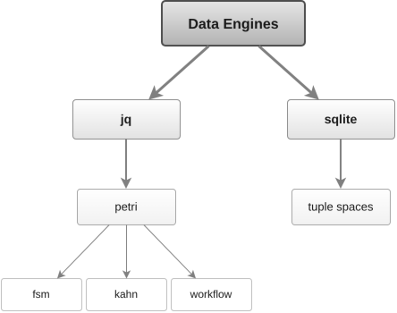

<!-- header # data-engines "Data Engines" | ^ ../README.md#engines | Workspaces #creating-a-workspace | CRUD #workspace-CRUD | Failures #failures | Deadlines #deadlines | Backings #backings | jq #jq-workspaces | sqlite #sqlite-workspaces | Refs #references -->
<h1><a id="data-engines"></a><a href="../README.md#engines"><picture><source media="(prefers-color-scheme: dark)" srcset="img/hdr/docs-data-engines.data-engines.up.dark.svg"></picture></a>Data Engines<a href="#references"><picture><source media="(prefers-color-scheme: dark)" srcset="img/hdr/docs-data-engines.data-engines.7.dark.svg"></picture></a><a href="#sqlite-workspaces"><picture><source media="(prefers-color-scheme: dark)" srcset="img/hdr/docs-data-engines.data-engines.6.dark.svg"></picture></a><a href="#jq-workspaces"><picture><source media="(prefers-color-scheme: dark)" srcset="img/hdr/docs-data-engines.data-engines.5.dark.svg"></picture></a><a href="#backings"><picture><source media="(prefers-color-scheme: dark)" srcset="img/hdr/docs-data-engines.data-engines.4.dark.svg"></picture></a><a href="#deadlines"><picture><source media="(prefers-color-scheme: dark)" srcset="img/hdr/docs-data-engines.data-engines.3.dark.svg"></picture></a><a href="#failures"><picture><source media="(prefers-color-scheme: dark)" srcset="img/hdr/docs-data-engines.data-engines.2.dark.svg"></picture></a><a href="#workspace-CRUD"><picture><source media="(prefers-color-scheme: dark)" srcset="img/hdr/docs-data-engines.data-engines.1.dark.svg"></picture></a><a href="#creating-a-workspace"><picture><source media="(prefers-color-scheme: dark)" srcset="img/hdr/docs-data-engines.data-engines.0.dark.svg"></picture></a><br clear="all"></h1>
<!-- /header -->

**Language Engines vs Data Engines.** Both involve wrapping and running a guest language, but whereas language-engines involve [namespaces](FFI.md#namespaces), data-engines get that plus [workspaces](#creating-a-workspace), and some differences with [import mode](#import-mode). 

Data-engines are interesting because besides the [simple stuff](#creating-a-workspace), amk also leverages them into **collaborative concurrent datastructures**, including garden variety [locking and horcrux](dsys.md#locks) but also [smart stacks](#jq-workspaces) and [reactive](runtime.md#tuplespace-reactor) [tuplespaces](tspace.md), all of which can allow for guest interop without the host in the middle.

The core data-engines are `jq` and `sqlite`, both embedded/linked into the `amk` binary with no need for external prerequisites.  Derived datastructures might *just* be datastructures, but might also be a [stacked engine](FFI.md#stacked-engines) in their own right.  For example the tuplespace *does* support it's own concept of [workspace](#creating-a-workspace) and despite having an [instruction set](tspace.md#operations) of its own, it supports raw SQL like the [sqlite engine](#sqlite-workspaces) that it extends.

<p align="center"></p>

<!--Engines derived from these  their state is a workspace, a jq value or a sqlite
database, that programs read and change through a fixed set of verbs. The verbs and the
forms every engine shares are in [the FFI](FFI.md#data-engines); this page covers what is
particular to workspaces and to each engine.

But whereas language-engines bring callables and values, and data-engines bring data stores which are (optionally) initialized with a value. -->

<a id="creating-a-workspace"></a>

## Workspaces

A workspace is a named store a data engine holds: one JSON value for jq, one database for
sqlite. It lives in the make process for the whole run, so a makefile, every guest and
every recipe reach the same one, each change lands in turn, and each moves its
[version](#version-and-wait). It is created empty or seeded:

```Makefile
# empty, in memory or with a backing
$(jq.ns.create jobs)
$(sqlite.ns.create edges, owned=edges.db)

# the same create, through the engine's namespace function
$(jq.ns queue, create)

# seeded from text, as a callform or above a define
$(jq.import config, {"retries": 3})

@jq.import
define limits
  {"max": 10}
endef

# each form also makes the workspace's handles
$(info $(config.get .retries) $(limits.get .max))   # 3 10
```

Any data engine takes the place of `jq` or `sqlite`. A create takes an optional
[backing](#backings), and an import [loads the text](#import-mode) it is given.

<a id="import-mode"></a>

### Import Mode

A data engine's `import` creates a workspace and seeds it. It only loads data, the text
`load` takes: one JSON text for jq, statements for sqlite. Nothing in it becomes a make
function. The define's name is the workspace's name, and importing a name again replaces
its value and keeps its handles.

```Makefile
@jq.import
define cfg
  {"name": "amk", "engines": ["lua", "s7"], "jobs": 2}
endef

$(cfg.update .engines += ["js"] | .jobs += 1)
$(jq.import cfg, {"name": "amk", "jobs": 1})
```

A language engine's `import` is different: it runs code and lifts what the code defines.
See [import mode](../README.md#import-mode) in the README.

<a id="workspace-CRUD"></a>

## Workspace CRUD

A makefile reaches a workspace through its handles, one per verb:

```Makefile
$(jq.ns.create stack)
seed  := $(stack.update [1, 2])
depth := $(stack.get length)
```

Library code takes the workspace's name as an argument, which a handle cannot, so it
spells the operation with the name first.
[demos/jq-stack.amk](../demos/jq-stack.amk) builds a stack this way, and the tuple-space and actor
libraries reach their workspaces only through it.

```Makefile
stack.push  = $(jq.ns $1, update, . + [$2])
stack.depth = $(jq.ns $1, get, length)
```

<a id="version-and-wait"></a>

### Version and Wait

Beside the engine's verbs, the ask channel answers two ops on every workspace. Each
`update` or `load` that changes the workspace moves its version.

| Op | From a recipe | Answers |
| --- | --- | --- |
| `version` | `amk.ns version jobs` | the workspace's version |
| `wait` | `amk.ns wait jobs -- 7` | the version, once it is past 7; status 3 when the owner exits first |

`wait` blocks, so it runs from a recipe, a target or a spawned job; from the makefile
itself, the owner would wait on itself and make stops.

A stacked engine of the [data variety](FFI.md#data-variety) answers the same two ops on
its stores, which are its guest's workspaces: the [dsys forms](dsys.md) keep a net, a
workflow, a Kahn network or a state machine in a jq workspace, and `<name>.version` moves
when a `petri.update` changes it.

<a id="workspace-pools"></a>

### Workspace Pools

A workspace can stand in for a [pool](pool.md). In the [tuple space](tspace.md), a
sqlite workspace, n identical tuples are a semaphore of size n: a blocking `in` takes one
and `out` puts it back, and the owner parks a taker until one lands. The two differ by
reach. A pool lives in a pipe, so any process holding its descriptor takes a token with no
owner in the middle; a workspace's tokens are typed, matched by pattern and inspectable, and
every take goes through the owner. [dsys](dsys.md#pool-users) lists both beside the other
flavors' holders, and the [reactor's workers](runtime.md#reactor-workers) take work this way.

<a id="made-on-first-use"></a>

### Ready on Demand

An [ask](FFI.md#calls-from-a-recipe) on a name no engine holds makes a workspace on first
use, in the first data engine of the build, which is jq. A workspace made this way has no
handles:

```Makefile
SHELL := bash
# 1
tally:
	source amk.sh; amk.ns update tally -- '.n += 1'
	source amk.sh; amk.ns get tally -- '.n'
```

<a id="failures"></a>

## Failures

An operation that fails stops the run at the expansion, as any engine's call does
([failures](FFI.md#failures)), after the engine's own message, such as
`w.get: jq get exited with status 5`. Two nonzero statuses are answers, not failures: jq's
`-e` status for a false, null or missing last output, and a `--deadline` that ran out,
which answers empty.

<a id="deadlines"></a>

## Deadlines

sqlite has no guest handle, so it takes `--deadline ms` among its leading options. The
call reports `deadline: <ms> ms` on stderr and answers empty, and the workspace keeps its
state. jq has no check, so a call into it ends only when it returns. A guest bounds its own
calls with `amk.deadline`, in [the runtime's deadlines](runtime.md#deadlines).

```Makefile
$(sqlite.ns.create w)
rows := $(w.get --deadline 100 SELECT count(*) AS n FROM big)
```

<a id="backings"></a>

## Backings

A backing says where a workspace lives besides the make process. A workspace has at most
one, declared at `create`; a repeat must match.

| Backing         | Does |
| ---             | --- |
| `run`           | default, in-memory, workspace lives in the host process |
| `owned=<path>`  | file-system backed workspace, loaded at use, flushed after write |
| `shared=<path>` | like owned, but auto reloads on version changes, picking up peer edits |

An engine with `open` uses the file as its store directly, held alone when owned. Each
engine reads a backing its own way:

| Backing         | jq | sqlite |
| ---             | --- | --- |
| `owned=<path>`  | loads the file at first use, writes it after every `update` and `load` | file *is* the database, held by this process alone |
| `shared=<path>` | file-backed, automatically reloading when version moves | the file is the database, and owners on one host take turns, each `update` one transaction |

```Makefile
$(sqlite.ns.create edges, owned=edges.db)
$(edges.update CREATE TABLE IF NOT EXISTS e(a, b))
```

<a id="jq-workspaces"></a>

## jq

The workspace is one JSON value.

| Verb | Runs | Stores | Prints |
| --- | --- | --- | --- |
| `get prog` | `prog` over the value | nothing | every output |
| `update prog` | `prog` over the value | the first output | the rest |
| `load text` | | the one JSON text, once it parses | nothing |
| `dump` | `.` | nothing | the value |

```Makefile
# a stack in a workspace: push, then pop the top and keep the rest
$(jq.ns.create stack)
seed  := $(stack.update [1] + [2])
push  := $(stack.update --argjson v 3 . + [$$v])
pop   := $(stack.update .[:-1], .[-1])
depth := $(stack.get length)
# a string output printed bare
$(jq.ns.create who)
name := $(who.update {"name": "a b"})
who  := $(who.get -r .name)
```

<a id="sqlite-workspaces"></a>

## sqlite

The workspace is one in-memory database. A program is one or more statements, and each
result row prints as a JSON object on a line. `--arg name value` binds `:name` as text;
`--argjson name json` binds the value its JSON names.

| Verb | Runs | Prints |
| ---           | --- | --- |
| `get prog`    | the statements; one that writes is refused | each row |
| `update prog` | the statements, writes included | each row |
| `load text`   | drops every table, view and trigger, then replays the text, in one transaction | nothing |
| `dump`        | | schema and rows, as statements |

```Makefile
@sqlite.import
define edges
  CREATE TABLE e(a INTEGER, b INTEGER);
  INSERT INTO e VALUES(1,2),(2,3),(3,1);
endef

seen := $(edges.get WITH RECURSIVE r(x) AS (SELECT 1 UNION SELECT b FROM e, r WHERE a = x) SELECT json_group_array(x) AS seen FROM r)
$(edges.update --arg a 3 INSERT INTO e VALUES(:a, 4))
```

<a id="references"></a>

## References

- [The FFI](FFI.md#data-engines), the verbs and forms every data engine shares.
- [tspace](tspace.md), the tuple space built on a sqlite workspace.
- [Pool](pool.md), and [workspace pools](#workspace-pools) for when a workspace is one.
- [The runtime](runtime.md#tuplespace-reactor), where a workspace's owner is the reactor.
- [jq](https://en.wikipedia.org/wiki/Jq_(programming_language)) and [SQLite](https://en.wikipedia.org/wiki/SQLite), on Wikipedia.
