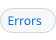

<!-- header # kahn "`mod :: dsys/kahn`" |Syntax #syntax | Reduction #reduction | API #api | Errors #errors | Demos #demos | Refs #references | Schema #schema -->
<h1><a id="kahn"></a><a href="dsys.md"><picture><source media="(prefers-color-scheme: dark)" srcset="img/hdr/docs-kahn.kahn.up.dark.svg"></picture></a><picture><source media="(prefers-color-scheme: dark)" srcset="img/hdr/docs-kahn.kahn.title.dark.svg"></picture><a href="#schema"><picture><source media="(prefers-color-scheme: dark)" srcset="img/hdr/docs-kahn.kahn.6.dark.svg"></picture></a><a href="#references"><picture><source media="(prefers-color-scheme: dark)" srcset="img/hdr/docs-kahn.kahn.5.dark.svg"></picture></a><a href="#demos"><picture><source media="(prefers-color-scheme: dark)" srcset="img/hdr/docs-kahn.kahn.4.dark.svg"></picture></a><a href="#errors"><picture><source media="(prefers-color-scheme: dark)" srcset="img/hdr/docs-kahn.kahn.3.dark.svg"></picture></a><a href="#api"><picture><source media="(prefers-color-scheme: dark)" srcset="img/hdr/docs-kahn.kahn.2.dark.svg"></picture></a><a href="#reduction"><picture><source media="(prefers-color-scheme: dark)" srcset="img/hdr/docs-kahn.kahn.1.dark.svg"></picture></a><a href="#syntax"><picture><source media="(prefers-color-scheme: dark)" srcset="img/hdr/docs-kahn.kahn.0.dark.svg"></picture></a><br clear="all"></h1>
<!-- /header -->

<a id="overview"></a>

Part of the [dsys toolkit](dsys.md), the `@kahn` syntax declares a Kahn process network[^kahn] as data and compiles it to an open [Petri net](petri.md):

```Makefile
load dsys/kahn

@kahn
define parity
  {
    "channels": { "numbers": ["1", "2", "3"], "evens": [], "odds": [] },
    "processes": {
      "split": { "run": "split", "reads": ["numbers"], "writes": ["evens", "odds"] },
      "even":  { "run": "even", "reads": ["evens"] },
      "odd":   { "run": "odd", "reads": ["odds"] }
    },
    "final": {}
  }
endef
```

* every channel is a labeled [pool](pool.md),
* a process fires once it can read one token from each channel it reads, and
* its step writes to its channels itself, so what it writes may depend on what it read.

One reader and one writer per channel keep the result fixed, whatever order the processes fire in.

<a id="syntax"></a>

## Syntax

| Form | Declares |
| --- | --- |
| `@kahn` above a define | a network of the define's name, compiled to a net of the same name, `<name>.__main__` its target |
| `@<name>.proc/<engine> (<reads...> > <writes...>)` above a define | a process joining the network late: the define its body, a target of the engine, the channels before `>` those it reads and those after it those it writes; the net is compiled and loaded again |
| `$(kahn.compile name)` | the compiled net's JSON, without loading it |

A network may declare only its channels and take every process by at line:

```Makefile
@kahn
define fb
  { channels: { next: ["1"], numbers: [] } }
endef

@fb.proc/lua (next > next numbers)
define gen
  local n = tonumber(amk.var["fb.gen.token"])
  amk.pool.produce("fb.numbers", tostring(n))
  if n < 15 then amk.pool.produce("fb.next", tostring(n + 1)) end
endef
```

The `/<engine>` is the first positional, so `@fb.proc (lua next > next numbers)` is the same
process; see [decorator arguments](grammar.md#decorator-arguments).

| Key | Value |
| --- | --- |
| `channels` | each channel's name and its initial tokens, a list of labels |
| `processes` | each process's name, `[a-z0-9_-]+`, and its keys below |
| `final` | optional; the final marking, as for a [net](petri.md#endings) |

| Process key | Value |
| --- | --- |
| `run` | the target the process runs per firing |
| `reads` | the channels it reads one token from; at least one |
| `writes` | the channels its step may produce into |

A step reads the token it took as `<name>.<process>.token` and writes with `amk.pool.produce("<name>.<channel>", value)`.

<a id="reduction"></a>

## Reduction

`kahn.jq` compiles the JSON once, at parse, and hands the net to `petri.load`:

| Network part | Becomes |
| --- | --- |
| Achannel | a labeled place of the same name |
| Aprocess | a transition with an arc from each channel it reads |
| `writes` | no arcs: the step produces into its channels |
| Thenetwork | an open net, strategy `open`, with a final marking only when `final` is given |

Without `final`, a network that loops ends holding tokens and waits as an open net does, under `petri.patience`.

<a id="api"></a>

## API

| Call | Does | Answers |
| --- | --- | --- |
| `<name>.__main__` | runs the network as its net; typically `__main__: <name>.__main__` | a target |
| `$(<name>.net )` | reads back the compiled net | the net's JSON |
| `$(<name>.marking )`, `$(<name>.trace)`, `$(<name>.step )` | as for [any net](petri.md#api) | words |
| `$(<name>.exec prog)` | a jq program over the net, the network's JSON as `$source` and the library as `kahn::` | what it prints |
| `$(<name>.version )` | the network's workspace version, which a `.proc` joining moves | a number |

`kahn` is a [stacked engine](FFI.md#stacked-engines) on jq, so `@kahn.target`,
`@kahn.import` and `@kahn.exec (name)` are its at lines and [`load ./parity.kahn`](petri.md#loading) reads a
file as a network.

<a id="errors"></a>

## Errors

A body that fails the [schema](#schema) is refused first, with every error it has, as in
`fb: does not meet schema/kahn.json: Property processes: Additional property idle: Missing required: reads`.
That covers the keys, the process names, and a process that reads nothing. The compiler
then refuses what a schema cannot say, before any net exists:

| Condition | Message |
| --- | --- |
| Aread or write that is no channel | `p: names c, which is no channel` |
| Achannel with two readers | `c: has 2 readers, not 1` |
| Achannel with two writers | `c: has 2 writers, not 1` |

The `kahn.compile` function runs the compiler alone, without the schema, so a malformed body
given to it directly fails as a jq error.

A process joining by `@<name>.proc` is checked the same way: the whole network against the
schema after it joins, then the compiler when the net is compiled again. Before that, its at
line is refused for:

| Condition | Message |
| --- | --- |
| No engine | `p: a .proc needs an engine` |
| Anengine with no target form | `p: nope has no @nope.target for a process body` |

<a id="demos"></a>

## Demos

| Demo | Shows |
| --- | --- |
| [`kahn-parity.amk`](../demos/kahn-parity.amk) | a step writing by its value |
| [`kahn-fizzbuzz.amk`](../demos/kahn-fizzbuzz.amk) | a generator process feeding a network read by four guests |
| [`kahn-fibonacci.amk`](../demos/kahn-fibonacci.amk) | a feedback loop holding state in its tokens |
| [`kahn-proc.amk`](../demos/kahn-proc.amk) | kahn-fizzbuzz with every process joined late by `@fb.proc/<engine>` |

<a id="references"></a>

## References

- [Petri nets](petri.md), what a network compiles to.
- [Workflows](workflow.md), the other form that compiles to a net.
- [dsys](dsys.md), the topic this module is a part of.
- [Kahn process networks](https://en.wikipedia.org/wiki/Kahn_process_networks), on Wikipedia.

[^kahn]: Gilles Kahn, "The Semantics of a Simple Language for Parallel Programming", Information Processing 74, 1974.

<a id="schema"></a>

## Schema

The full form, as a JSON Schema, is [`schema/kahn.json`](../payload/lib/dsys/schema/kahn.json),
and every `@kahn` body is checked against it before it compiles. A network is also refused for
what a schema cannot say, as [errors](#errors) lists: a process naming no channel, or a channel
with more than one reader or writer.

```json
{
  "$schema": "https://json-schema.org/draft/2020-12/schema",
  "$id": "kahn.json",
  "title": "@kahn",
  "description": "a Kahn network under @kahn: channels holding tokens and processes reading and writing them, compiled by kahn.jq to an open net; one reader and one writer per channel, and every name a process uses a channel, are checked by the compile",
  "type": "object",
  "additionalProperties": false,
  "required": ["channels"],
  "properties": {
    "channels": {
      "description": "each channel and the tokens it starts with, in order; a channel is a labeled place of the net",
      "type": "object",
      "propertyNames": { "pattern": "^[A-Za-z0-9_.-]+$" },
      "additionalProperties": {
        "type": "array",
        "items": { "type": "string", "pattern": "^[^\\s$#\\\\]{1,31}$" }
      }
    },
    "processes": {
      "description": "each process by name: the target it runs and the channels it reads one token from and may write to; more join by the at line @<name>.proc",
      "type": "object",
      "default": {},
      "propertyNames": { "pattern": "^[a-z0-9_-]+$" },
      "additionalProperties": {
        "type": "object",
        "additionalProperties": false,
        "required": ["run", "reads"],
        "properties": {
          "run": { "description": "the target a firing runs", "type": "string", "minLength": 1 },
          "reads": {
            "description": "the channels it takes one token from per firing",
            "type": "array",
            "minItems": 1,
            "items": { "type": "string" }
          },
          "writes": {
            "description": "the channels its target produces to itself",
            "type": "array",
            "items": { "type": "string" }
          }
        }
      }
    },
    "final": {
      "description": "the token counts the network must end with, by channel; without it, the end is not checked",
      "type": "object",
      "additionalProperties": { "type": "integer", "minimum": 0 }
    }
  }
}
```
