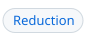
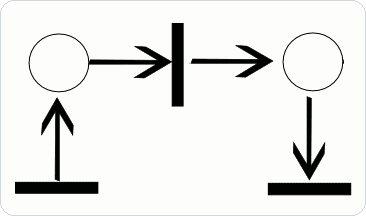

<!-- header # petri "`mod :: dsys/petri`" |Concepts #concepts | Syntax #syntax | Runtime #amk-block | Endings #endings | Strategy #strategy | API #api | Reduction #reduction | Errors #errors | Demos #demos | Refs #references | Schema #schema -->
<h1><a id="petri"></a><a href="dsys.md"><picture><source media="(prefers-color-scheme: dark)" srcset="img/hdr/docs-petri.petri.up.dark.svg"></picture></a><a href="../README.md#module-index"><picture><source media="(prefers-color-scheme: dark)" srcset="img/hdr/docs-petri.petri.mod.dark.svg"></picture></a><picture><source media="(prefers-color-scheme: dark)" srcset="img/hdr/docs-petri.petri.title.dark.svg"></picture><a href="#schema"><picture><source media="(prefers-color-scheme: dark)" srcset="img/hdr/docs-petri.petri.10.dark.svg"></picture></a><a href="#references"><picture><source media="(prefers-color-scheme: dark)" srcset="img/hdr/docs-petri.petri.9.dark.svg"></picture></a><a href="#demos"><picture><source media="(prefers-color-scheme: dark)" srcset="img/hdr/docs-petri.petri.8.dark.svg"></picture></a><a href="#errors"><picture><source media="(prefers-color-scheme: dark)" srcset="img/hdr/docs-petri.petri.7.dark.svg"></picture></a><a href="#reduction"><picture><source media="(prefers-color-scheme: dark)" srcset="img/hdr/docs-petri.petri.6.dark.svg"></picture></a><a href="#api"><picture><source media="(prefers-color-scheme: dark)" srcset="img/hdr/docs-petri.petri.5.dark.svg"></picture></a><a href="#strategy"><picture><source media="(prefers-color-scheme: dark)" srcset="img/hdr/docs-petri.petri.4.dark.svg"></picture></a><a href="#endings"><picture><source media="(prefers-color-scheme: dark)" srcset="img/hdr/docs-petri.petri.3.dark.svg"></picture></a><a href="#amk-block"><picture><source media="(prefers-color-scheme: dark)" srcset="img/hdr/docs-petri.petri.2.dark.svg"></picture></a><a href="#syntax"><picture><source media="(prefers-color-scheme: dark)" srcset="img/hdr/docs-petri.petri.1.dark.svg"></picture></a><a href="#concepts"><picture><source media="(prefers-color-scheme: dark)" srcset="img/hdr/docs-petri.petri.0.dark.svg"></picture></a><br clear="all"></h1>
<!-- /header -->

<a id="overview"></a>

Part of the [dsys toolkit](dsys.md), the `@petri` syntax embeds a petri net[^murata] as data:

```Makefile
load dsys/petri

@petri
define flow
  {"places": {"ready": 1, "done": 0}, "transitions": ["work"], "arcs": [...],
   "amk": {"steps": {"work": {"run": "build"}}}}
endef

build:
	@echo working

__main__: flow.__main__
```

Unless you *directly* want to encode a [discrete-event dynamic system](runtime.md#automata) as a petri net.. you probably will not use `@petri` directly.  Petri nets are primarily a *compilation target*, i.e. a lingua franca that everything from [state machines](fsm.md) to workflows can use, lowered or lifted as needed.  See also the main docs for the [dsys topic](dsys.md), see [`dsys/workflow`](workflow.md): `@workflow` for a task graph, and [`dsys/kahn`](kahn.md): `@kahn` for a Kahn network.


Lowering or lifting other abstractions to/from petri nets as a compilation project works, but it's also *executable* because **petri nets are a [runtime](runtime.md#automata) for amk**.  This works because:

1. Petri places are [pools](dsys.md#pools), 
1. Places can hold tokens, 
1. Transitions move tokens, and 
1. Each transition may run a step in any [guest engine](../README.md#engines).

<p align="center">
<br/>
Net firing, one transition at a time.  <br>Transition fires when the input place holds enough tokens; firing moves them to outputs. <br/>
<br/>
<br>
<sub><a href="https://commons.wikimedia.org/wiki/File:Animated_Petri_net_commons.gif">(mediawiki commons)</a></sub>
</p>

<a id="concepts"></a>

## Concepts

| Term | Meaning |
| --- | --- |
| Place | a pool named `<net>.<place>`, counted or labeled |
| Open Place | a place named under `amk.open`, which the environment may add tokens to at any time; its pool is opened with `strategy=open` |
| Token | one unit of a place; a labeled place's token carries a label of 1 to 31 bytes |
| Transition | consumes from its input places and produces into its output places when it fires |
| Arc | a place and a transition joined, with a weight, the tokens it moves per firing |
| Marking | how many tokens each place holds |
| Step | what a transition runs when it fires, by its kind |
| Kind | how a step runs: in place or as a job, its failure fatal or kept as an outcome |
| In Flight | a firing whose inputs are taken and whose job has not yet landed, counted as a token of `<t>.busy` |

<a id="syntax"></a>

## Syntax

The net's JSON is a minimal projection of PNML's[^pnml] place/transition core: `places`
with their initial marking, `transitions`, and `arcs`. Everything about running it lives
under one key, `amk`, described in [the next section](#amk-block):

```Makefile
load dsys/petri

@petri
define net
  {
    "places": { "ready": 1, "done": 0 },
    "transitions": ["work"],
    "arcs": [["ready", "work"], ["work", "done"]],
    "amk": { "steps": { "work": { "run": "job" } } }
  }
endef
```

| Form | Declares |
| --- | --- |
| `@petri` above a define | a net of the define's name, its places opened as pools and `<net>.__main__` its target |
| `@petri.target` above a define | the same, and a phony target of the net's name that runs `<net>.__main__` |
| `@petri.import` above a define | a file's text as the net: JSON, or PNML when the body is XML |
| `load net.petri`, `load net.pnml` | the file as a net named by its stem; `petri` is a [stacked engine](FFI.md#stacked-engines) on jq, so `load` routes its extensions here |
| `@petri.exec (net)` above a define | a jq program over the net, printed at parse; see [exec](#api-exec) |
| `$(petri.load name, json)` | the same from JSON text, as a front end compiles it |

A PNML body is read for its place/transition core: places with their initial marking,
transitions, and arcs with their inscription as weight. The `pnml` call in the [API](#api)
writes a net back out in the same form, without the `amk` block.

<a id="loading"></a>

### Loading

A net can live in a file of its own. `load` reads it as `@petri.import` reads a define, and
names the net after the file's stem:

```Makefile
load dsys/petri
load ./lights.petri   # JSON, the net named lights
load ./other.pnml     # PNML from another tool, the net named other
__main__: lights.__main__ other.__main__
```

`load` routes by extension, the way it routes `.lua` to lua: `petri` claims `.petri` and
`.pnml`, and each form claims its own, `.workflow`, `.kahn`, and `.fsm` or `.scxml`. A form's
library is loaded first, as `load dsys/kahn` before `load ./parity.kahn`; without it, `load`
stops with `no engine claims the extension`. A file in the working directory is named with
its directory, `./`, since a bare name is looked up as a library.

<a id="amk-block"></a>

## The amk Block

The three top-level keys are the net as any Petri tool reads it: its structure and its
initial marking. The `amk` key is everything amk adds to run it as a program: what each
firing does, who may feed the net, how it ends, and what must hold along the way. A net
without the block is a pure token game, and a net compiled by a [form](#reduction) is
mostly its block.

| Key | Role | Value |
| --- | --- | --- |
| `steps` | what a transition runs when it fires | by transition, `{ "run": target, "kind": .. }`; `goal` and `goal.maybe` run in place, `agoal` and `agoal.maybe` as a job, in flight as a token of `<t>.busy`; a `.maybe` failure is an outcome kept as the token's label, any other stops the run |
| `open` | the places the environment feeds | a list of places, each opened with strategy `open`; see [endings](#endings) |
| `strategy` | who may add tokens to the net's other places | `default`, `strict` or `open`; see [strategy](#strategy) |
| `pools` | existing pools used as places | by place name, the open pool it stands for; its tokens bound the firings that take them |
| `final` | how a run ends | a marking by place, or a list of markings any of which ends the run; a place left out wants 0; see [endings](#endings) |
| `guard` | when a transition may fire, beyond its tokens | by transition, a rule over the labels it reads (`all success`, `any failed` and their negations) or `{ "label": x }`, the one label every input must carry |
| `label` | what label a transition gives the tokens it produces | by transition, `outcome` for its step's outcome, `output` for its step's last printed value, which then goes to the token and not the console, `skipped`, `merge`, or `{ "items": [..] }`, the n-th item for the n-th token; without one the label it took passes on |
| `invariants` | what must hold whenever nothing is in flight | a list of weighted sums over places and `<t>.busy` counts, each with its total under `=`; a broken one stops the run |
| `backend` | which runner takes the net | `petri`, the only one today |

A transition with no `steps` entry moves tokens and runs nothing. Labels and guards are
how the [workflow](workflow.md) form carries outcomes: each task's step is `goal.maybe`, its
result the label of the token it produces, and the next task's guard reads that label.

<a id="endings"></a>

## Endings

`<net>.__main__` fires until no transition is enabled and no firing is in flight. What happens
then depends on the final marking and on the net's open places, the places named under
`amk.open`, which the environment may add tokens to at any time:

| # | Nothing enabled, and | Reading | The run |
| --- | --- | --- | --- |
| E1 | the final marking holds | proper completion | ends |
| E2 | no place is open | a dead marking | ends, and fails if a final marking is declared and missed |
| E3 | some place is open | quiescent: the environment may still enable a transition | waits, then fires again once a transition is enabled |

An open net waits for its input. Here `in` starts empty, so nothing is enabled until a guest
produces into it, and the run ends once `out` holds two tokens:

```Makefile
load dsys/petri

@petri
define relay
  {
    "places": { "in": [], "out": 0 },
    "transitions": ["pass"],
    "arcs": [["in", "pass"], ["pass", "out"]],
    "amk": { "open": ["in"], "final": { "out": 2 } }
  }
endef
```

Any process may produce into an open place, a spawned job included, as
`amk.pool.produce("relay.in", "a")` in lua. A net with open places and no final marking
waits until stopped. `petri.patience` bounds the wait in seconds; past it the run fails.
`petri.poll_ms` sets how often a waiting net looks again.

`final` may also be a list of markings, and the run ends when any one of them holds. A
machine with two acceptance states, pass and fail, compiles to such a net:

```json
"amk": { "final": [{ "pass": 1 }, { "fail": 1 }] }
```

A place a marking leaves out wants 0, in a list as in one marking, so a token left in an
open place keeps every alternative from holding.

<a id="strategy"></a>

## Strategy

The feeding keys of the [`amk` block](#amk-block), as the schema states them:

```json
{
  "strategy": {
    "enum": ["default", "strict", "open"],
    "default": "default",
    "description": "who may add to the net's places: default and strict, only the process running the net; open, any process"
  },
  "open": {
    "type": "array",
    "items": { "description": "a place of the net" },
    "default": [],
    "description": "the places the environment feeds, each opened with strategy open; see endings"
  }
}
```

An enabled transition fires in `transitions` order. `petri.patience` and `petri.poll_ms`
time an open net's wait, as [endings](#endings) describes.

<a id="api"></a>

## API

| Call | Does | Answers |
| --- | --- | --- |
| `<net>.__main__` | fires the net until no transition is enabled and none is in flight; then it ends at the final marking, fails if a final marking is declared and missed, or, with open places, waits for the environment | a target |
| `$(<net>.marking )`, `$(<net>.marking place)` | reads the marking, each agoal transition's `<t>.busy` included | `place=count` words, or one count |
| `petri.patience`, `petri.poll_ms` | how long an open net waits with nothing enabled, in seconds, empty for no limit; and how often it looks, 50 ms by default | variables |
| `$(<net>.states )`, `$(<net>.state t)` | reads each transition's state | `t=state` words, or one state |
| `$(<net>.trace)` | lists the firings so far, in order | transition names |
| `$(<net>.step )` | one firing, the first enabled transition, or none | the transition fired, or nothing |
| `$(<net>.exec prog)` | a jq program over the net with its state bound; see [exec](#api-exec) | what the program prints |
| `$(<net>.version )`, `$(petri.wait net, n)` | the net's workspace version, and a wait past one, as for any [data engine](data-engines.md#version-and-wait) | a number |
| `$(petri.update net, prog[, who])` | changes the net's source by a jq program, checks it against its form's schema as `who`, compiles and plans it again; the forms over petri join late this way | nothing |
| `$(petri.reload net, json)` | the net's JSON replaced in place and planned again | nothing |
| `$(petri.create name[, json])` | a net from text, or an empty one; the data variety's create | nothing |
| `$(<net>.pnml)` | the net as PNML | the XML text |

<a id="api-exec"></a>

### Exec

`<net>.exec` runs a jq program with the net's JSON as input and its state bound:
`$net` the name, `$marking` the counts by place, `$labels` the labeled places' tokens,
`$trace` the firings so far, `$inflight` the jobs out, and `$source` the JSON of the form
the net was compiled from, or null. The petri library is included, and a form's library is
imported under its name, so `kahn::net` is reachable from a Kahn network's exec.

```Makefile
@n.exec
define report
  "\($trace | length) firings, \($marking.done) done"
endef

fired := $(n.exec $$trace | join(","))
```

An exec reads; it never fires. A step's recipe runs in a child, where the net's pools are
counted by the process that opened them, so `<net>.exec` inside a step stops make.

<a id="api-guests"></a>

### Guests

A net has no guest binding. A step reads its firing through `amk.var`, as
`<net>.firing` and `<net>.<t>.token`, and writes to an open net's places through the
[pool handle](pool.md#api).

<a id="reduction"></a>

## Reduction

A higher form compiles its JSON to a net's JSON once, at parse, and hands it to
`petri.load`. The result is an ordinary net with every call above, and `<name>.net` reads
back what it compiled to.

| Form | Page |
| --- | --- |
| `@workflow`, a task graph | [Workflows](workflow.md) |
| `@kahn`, a Kahn network | [Kahn networks](kahn.md) |
| `@fsm`, a state machine | [State machines](fsm.md) |

Each form is a stacked engine of its own on jq, of the [data variety](FFI.md#data-variety):
`<name>.exec`, `<name>.step`, `<name>.version` and the rest of the calls above work on its
net, `@<form>.target`, `@<form>.import` and `@<form>.exec` are its at lines, and `load`
routes the form's extension to it.

<a id="errors"></a>

## Errors

| Condition | Message |
| --- | --- |
| An arc that does not join a place and a transition | `n: arc a to b does not join a place and a transition` |
| `amk.open` naming no place | `n: open place c is not a place of the net` |
| A place named like an agoal transition's in-flight count | `n: t.busy is both a place and the in-flight count of a transition` |
| A final marking missed with no open place | `n: stuck with b at 1, the final marking wants 0` |
| Every one of several final markings missed | `n: stuck at a=0 b=1 c=0, none of 2 final markings met` |
| An open net waiting past `petri.patience` | `n: quiescent for 1s, nothing enabled and nothing arrived in in` |

<a id="demos"></a>

## Demos

| Demo | Shows |
| --- | --- |
| [`petri-lights.amk`](../demos/petri-lights.amk) | Murata's two traffic lights, with cars as labeled tokens |
| [`petri-batch.amk`](../demos/petri-batch.amk) | agoal steps in flight at once, bounded by a pool of runners |

<a id="references"></a>

## References

- [Pools](pool.md), the places every net is made of.
- [Workflows](workflow.md), [Kahn networks](kahn.md) and [state machines](fsm.md), the forms that compile to a net.
- [dsys](dsys.md), the topic this runtime is a part of.
- [The FFI](../docs/FFI.md), the engine API every guest shares.
- [Petri net](https://en.wikipedia.org/wiki/Petri_net), on Wikipedia.
- [Kahn process networks](https://en.wikipedia.org/wiki/Kahn_process_networks), on Wikipedia.

[^murata]: Tadao Murata, "Petri Nets: Properties, Analysis and Applications", Proceedings of the IEEE 77(4), 1989, [doi:10.1109/5.24143](https://doi.org/10.1109/5.24143).
[^pnml]: ISO/IEC 15909-2:2011, "High-level Petri nets, Part 2: Transfer format", [pnml.org](https://www.pnml.org/).

<a id="schema"></a>

## Schema

The full form of a net's JSON, as a JSON Schema, [`schema/petri.json`](../payload/lib/dsys/schema/petri.json),
and every `@petri` body is checked against it as the makefile is read.
The nets that `@workflow` and `@kahn` compile are of the same form. A net is also refused for
what a schema cannot say, as [errors](#errors) lists: an arc that does not join a place and a
transition, or a transition with no input place.

```json
{
  "$schema": "https://json-schema.org/draft/2020-12/schema",
  "$id": "petri.json",
  "title": "@petri",
  "description": "a net under @petri: the place/transition core of PNML, with what only amk reads under amk",
  "type": "object",
  "required": ["places", "transitions", "arcs"],
  "additionalProperties": false,
  "properties": {
    "places": {
      "description": "each place and its initial marking: a count of plain tokens, or a list of labels for a labeled place",
      "type": "object",
      "propertyNames": { "$ref": "#/$defs/name" },
      "additionalProperties": {
        "oneOf": [
          { "type": "integer", "minimum": 0 },
          { "type": "array", "items": { "$ref": "#/$defs/label" } }
        ]
      }
    },
    "transitions": {
      "description": "the transitions, in the order an enabled one is chosen to fire",
      "type": "array",
      "items": { "$ref": "#/$defs/name" }
    },
    "arcs": {
      "description": "place to transition or transition to place, with a weight, the tokens it moves per firing",
      "type": "array",
      "items": {
        "type": "array",
        "prefixItems": [
          { "$ref": "#/$defs/name" },
          { "$ref": "#/$defs/name" },
          { "type": "integer", "minimum": 1, "default": 1 }
        ],
        "minItems": 2,
        "maxItems": 3
      }
    },
    "amk": {
      "description": "what only amk reads; PNML export leaves it out",
      "type": "object",
      "additionalProperties": false,
      "properties": {
        "backend": {
          "enum": ["petri"],
          "default": "petri"
        },
        "strategy": {
          "description": "who may add to the net's places: default and strict, only the process running the net; open, any process",
          "enum": ["default", "strict", "open"],
          "default": "default"
        },
        "open": {
          "description": "the places the environment feeds, each opened with strategy open",
          "type": "array",
          "items": { "$ref": "#/$defs/name" },
          "default": []
        },
        "pools": {
          "description": "names usable in arcs as places, each an existing open pool, by the pool's name",
          "type": "object",
          "propertyNames": { "$ref": "#/$defs/name" },
          "additionalProperties": { "type": "string" }
        },
        "steps": {
          "description": "what each transition runs when it fires, by transition",
          "type": "object",
          "additionalProperties": {
            "type": "object",
            "additionalProperties": false,
            "required": ["run"],
            "properties": {
              "run": {
                "description": "a target, or targets run in order; the last one's value is the step's output",
                "oneOf": [
                  { "type": "string" },
                  { "type": "array", "items": { "type": "string" }, "minItems": 1 }
                ]
              },
              "bind": {
                "description": "make variables set before the step runs, each a word",
                "type": "object",
                "additionalProperties": { "type": "string", "pattern": "^[^\\s=]*$" }
              },
              "kind": {
                "description": "goal and goal.maybe run in place; agoal and agoal.maybe run as a job, in flight as a token of <t>.busy; a .maybe failure is an outcome, not fatal",
                "enum": ["goal", "goal.maybe", "agoal", "agoal.maybe"],
                "default": "goal"
              }
            }
          }
        },
        "guard": {
          "description": "a condition on the labels of a transition's inputs, by transition; each input it reads holds one token. a rule name over outcomes, or a label the token must carry",
          "type": "object",
          "additionalProperties": {
            "oneOf": [
              {
                "enum": [
                  "all success", "not all success", "any failed", "not any failed",
                  "all_success", "not_all_success", "any_failed", "not_any_failed"
                ]
              },
              {
                "type": "object",
                "properties": { "label": { "type": "string", "minLength": 1 } },
                "required": ["label"],
                "additionalProperties": false
              }
            ]
          }
        },
        "label": {
          "description": "the label a transition gives the tokens it produces, by transition; without one, the label it took passes on",
          "type": "object",
          "additionalProperties": {
            "oneOf": [
              { "enum": ["outcome", "skipped", "merge", "output"] },
              {
                "type": "object",
                "additionalProperties": false,
                "required": ["items"],
                "properties": {
                  "items": { "type": "array", "items": { "$ref": "#/$defs/label" } }
                }
              }
            ]
          }
        },
        "invariants": {
          "description": "weighted sums of places, and of <t>.busy counts, that hold whenever no firing is in flight",
          "type": "array",
          "items": {
            "type": "object",
            "required": ["="],
            "properties": { "=": { "type": "integer" } },
            "additionalProperties": { "type": "integer" }
          }
        },
        "final": {
          "description": "the marking a run ends at, by place, or the alternatives; a place left out wants 0",
          "oneOf": [
            { "$ref": "#/$defs/marking" },
            { "type": "array", "items": { "$ref": "#/$defs/marking" }, "minItems": 2 }
          ]
        }
      }
    }
  },
  "$defs": {
    "marking": {
      "type": "object",
      "additionalProperties": { "type": "integer", "minimum": 0 }
    },
    "name": {
      "description": "a place or transition; no name is both, and a place is not named <t>.busy for an agoal transition t",
      "type": "string",
      "pattern": "^[A-Za-z0-9_.-]+$"
    },
    "label": {
      "description": "a labeled token: 1 to 31 bytes, no whitespace, no $, # or backslash",
      "type": "string",
      "pattern": "^[^\\s$#\\\\]{1,31}$"
    }
  }
}
```
