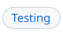
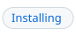

<!-- header # syntax-highlighting "Syntax highlighting" | ^ ../README.md#features | Highlights #what-it-highlights | Installing #installing | Grammars #engines-and-grammars | Testing #testing-the-grammars | Refs #references -->
<h1><a id="syntax-highlighting"></a><a href="../README.md#features"><picture><source media="(prefers-color-scheme: dark)" srcset="img/hdr/docs-syntax-hl.syntax-highlighting.up.dark.svg"></picture></a>Syntax highlighting<a href="#references"><picture><source media="(prefers-color-scheme: dark)" srcset="img/hdr/docs-syntax-hl.syntax-highlighting.4.dark.svg"></picture></a><a href="#testing-the-grammars"><picture><source media="(prefers-color-scheme: dark)" srcset="img/hdr/docs-syntax-hl.syntax-highlighting.3.dark.svg"></picture></a><a href="#engines-and-grammars"><picture><source media="(prefers-color-scheme: dark)" srcset="img/hdr/docs-syntax-hl.syntax-highlighting.2.dark.svg"></picture></a><a href="#installing"><picture><source media="(prefers-color-scheme: dark)" srcset="img/hdr/docs-syntax-hl.syntax-highlighting.1.dark.svg"></picture></a><a href="#what-it-highlights"><picture><source media="(prefers-color-scheme: dark)" srcset="img/hdr/docs-syntax-hl.syntax-highlighting.0.dark.svg"></picture></a><br clear="all"></h1>
<!-- /header -->

<a id="what-it-highlights"></a>

## What it highlights

An at line names the engine a define is written for, and the editor extension reads it the
same way amk does: the body of that define takes the engine's own grammar, and the rest of
the file keeps the editor's makefile highlighting. A define with no at line stays plain
make, whatever its name, since a name is only a convention.

```make
@lua.target
# blank and comment lines may stand between the at line and its define
define sorted
  local xs = {}
  for x in (">>nums.txt<<"):gmatch("%S+") do xs[#xs + 1] = tonumber(x) end
  print(table.concat(xs, " "))
endef
```

Here the body is lua up to its endef, even if the guest grammar is left mid-string. A body
reaches its engine unexpanded, so make references and goal references inside it are marked
on top of the guest grammar, strings included.

The engine word may follow a space or a troupe and `bind`, so `@shop.bind.lua (order
item=str)` is a lua body too, and `@amk.target` and `@bash.target` bodies take the shell
grammar. Every decorator's arguments are marked by the grammar in the FFI doc: a quoted
literal as a string, a `key=value` by its key, the parens group and the braces options by
their brackets, the prerequisites after the colon as targets, and the mark after the triple
colon as a keyword.

<a id="installing"></a>

## Installing

```bash
make vscode
```

This generates the grammars, packs them as `out/amk.vsix`, and installs that with the
`code` command; reload the window afterwards. It needs `node`, `zip`, and `code` on PATH.

<a id="engines-and-grammars"></a>

## Engines and grammars

| Engine | Grammar | Ships With the Editor |
| --- | --- | --- |
| lua | `source.lua` | yes |
| micropy | `source.python` | yes |
| js | `source.js` | yes |
| s7 | `source.scheme` | no |
| jq | `source.jq` | no |
| awk | `source.awk` | no |
| golang | `source.go` | yes |
| zig | `source.zig` | no |
| wat | `source.wat` | no |

A body whose grammar is missing is marked as embedded but shows uncolored until another
extension supplies that grammar: a zig or wat body under `@zig.import` or `@wat.import`
colors only once a Zig or WebAssembly extension is installed, while the make references
inside it are marked either way. The table lives in `vscode/build.js`, which generates one
block of the injection grammar per row.

<a id="testing-the-grammars"></a>

## Testing the grammars

The test tokenizes small makefiles with the same engine the editor uses, against the
makefile, lua, python, javascript, shell, and go grammars of an installed VS Code, with
small stand-in grammars for the scopes it does not ship, and checks the scope given to
each span.

```bash
cd vscode && npm install && npm test
```

Point `VSCODE_EXTENSIONS` at the extensions folder of an install outside the default macOS
location.

When a highlight looks wrong in the editor, run Developer: Inspect Editor Tokens and Scopes
on the token: the scopes it lists tell a grammar fault from a theme choice.

<a id="references"></a>

## References

Related pages:

- [Grammar](grammar.md), the extended syntax the grammars highlight.
- [The engine table](../README.md#engines), the guests whose define bodies get each language's highlighting.

Further reading:

- [Syntax highlighting](https://en.wikipedia.org/wiki/Syntax_highlighting), on Wikipedia.
