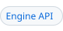

<!-- header # wasm "WebAssembly Engine" | Engine API #engine-api | Engine #engine | Zig #zig | Wat #wat | Go #golang | Cache #cache | Errors #errors | Refs #references -->
<h1><a id="wasm"></a>WebAssembly Engine<a href="#references"><picture><source media="(prefers-color-scheme: dark)" srcset="img/hdr/docs-wasm.wasm.7.dark.svg"></picture></a><a href="#errors"><picture><source media="(prefers-color-scheme: dark)" srcset="img/hdr/docs-wasm.wasm.6.dark.svg"></picture></a><a href="#cache"><picture><source media="(prefers-color-scheme: dark)" srcset="img/hdr/docs-wasm.wasm.5.dark.svg"></picture></a><a href="#golang"><picture><source media="(prefers-color-scheme: dark)" srcset="img/hdr/docs-wasm.wasm.4.dark.svg"></picture></a><a href="#wat"><picture><source media="(prefers-color-scheme: dark)" srcset="img/hdr/docs-wasm.wasm.3.dark.svg"></picture></a><a href="#zig"><picture><source media="(prefers-color-scheme: dark)" srcset="img/hdr/docs-wasm.wasm.2.dark.svg"></picture></a><a href="#engine"><picture><source media="(prefers-color-scheme: dark)" srcset="img/hdr/docs-wasm.wasm.1.dark.svg"></picture></a><a href="#engine-api"><picture><source media="(prefers-color-scheme: dark)" srcset="img/hdr/docs-wasm.wasm.0.dark.svg"></picture></a><br clear="all"></h1>
<!-- /header -->

WASM support in `amk` is via an interface that follows the [language engine API](#engine-api), using a cosmo'd wasm3 interpreter[^wasm3], bundled by default at 0.9.0.
Since WASM itself is effectively polyglot, we can build on top of this engine to create others known as [stacked engines](FFI.md#stacked-engines).  See the [golang](#golang) and [zig](#zig) support.

To put it another way: WASM is a *backup plan for any missing engine*, or what you might call a *factory for engines*.  Raw WASM can come from disk precompiled, or you can setup a bit of plumbing to specify a cross-compilation procedure that generates WASM on-demand.  

Either way.. guests can run in-process through wasm3, enjoy the [usual FFI](FFI.md#ffi), use [imports](../README.md#import-mode) to lift whole namespaces to be accessed by the amk runtime, or accessed guest-to-guest as usual.

You could also think of the wasm support as generalizing make's own `load`[^make-load], and serving a similar purpose.  In amk, `load module.wasm` just works the way you'd expect.  This is the file-backed alternative to the inline-and-import approach, and uses the usual [module search order](../README.md#modules).

<a id="see-also"></a>

## See Also

* upstream wasm3 interpreter[^wasm3] (0.9.0 bundled by default)
* main README's [basic overview](../README.md#wasm) of the wasm engine
* more detailed [capabilities table](FFI.md#capabilities-by-engine)
* amk's [wasm module](../payload/lib/amk/wasm.mk), wrapping the above into a toolkit and compilation pipeline over the engine
* Demos: [zig](../demos/wasm-zig.amk), [wasm text](../demos/wasm-wat.amk), and [golang](../demos/wasm-golang.amk); each usage section below is one of them

<a id="engine-api"></a>
<a id="forms"></a>

## Engine API

The wasm engine follows the [language engine](FFI.md#language-engines) API, with one
difference: its program is a module, not text. Every form below takes a module path, the
module's bytes in hex, or a source define that a toolchain builds into a module. The first
three forms are the engine's own; the rest come from the [wasm library](../payload/lib/amk/wasm.mk),
which turns a compiler into a [stacked engine](FFI.md#stacked-engines) of its own.

| Form | Does | When |
| --- | --- | --- |
| `$(wasm.import path-or-hex)` | loads a module into the kept runtime and lifts its exports as make functions; its value is the names | at the expansion |
| `$(wasm.exec name args...)` | calls one export by name, results on one line; `deadline ms` ahead of the name bounds the call | at the expansion |
| `$(wasm path args...)` | runs wasm3's own command line in a fork; `amk --wasm` is the same | at the expansion |
| `$(amk.engine name, guest=wasm, ...)` | registers a toolchain as an engine: a namespace, `@name.import`, `@name.target`, and the extensions `load` routes to it | at the expansion, once |
| `@name.import` | over a source define: the module built once by the toolchain and imported into the namespace; the value is the names | at parse time, once per input set |
| `@name.target` | over a source define: a phony target of the define's stem that builds the module when it runs and runs it as a wasi program | at parse time |
| `$(name define)` | the one-shot form: the define built as needed and run as a wasi program in a fork, its stdout the value | at the expansion |
| `$(name.exec fn args...)` | the namespace handle: one export of the toolchain's modules by name | at the expansion |

`wasm.import` lifts every export make can spell, and a call's arguments are numbers, split
on commas or spaces alike. A module reaches make through imports under the module name
`amk`:

| Import | Does |
| --- | --- |
| `print(ptr, len)` | writes to the call's value |
| `var_get(name, len, buf, cap)` | reads a make variable |
| `var_set(name, len, value, len)` | writes a make variable |
| `expand(text, len, buf, cap)` | expands text as make would |
| `eval(text, len)` | reads text as makefile syntax |

A reader answers the whole length, so a call with a short buffer can retry with a larger one.

<a id="engine"></a>

## Usage (Filesystem / Raw WASM)

```Makefile
# the exports, then a lifted call and the same call through exec: fib, 6765, 55
exports := $(wasm.import src/wasm3-0.9.0/test/lang/fib32.wasm)
twenty := $(fib 20)
ten := $(wasm.exec fib 10)

# a runaway call ends with "wasm: deadline: 100 ms" on stderr and answers empty
slow := $(wasm.exec deadline 100 fib 45)
```

The one-shot forms run wasm3's own command line in a fork, a module path and its
arguments; `amk --wasm` is that command line.

```bash
# prints "Result: 6765" on stderr
./amk --wasm --func fib src/wasm3-0.9.0/test/lang/fib32.wasm 20
```

<a id="zig"></a>

## Usage (Zig)

A function compiled in a container and called as a make function.

```Makefile
# Load the engine itself
load zig

# Now the engine's file extensions are supported by `load` too.
load ./demos/data/my_functions.zig

# Or, define functions inline.
@zig.import
define fib.zig
  export fn fib(n: u32) u32 {
      var a: u32 = 0;
      var b: u32 = 1;
      var i: u32 = 0;
      while (i < n) : (i += 1) {
          const t = a + b;
          a = b;
          b = t;
      }
      return a;
  }
endef

# Use the imported functions wherever they came from; other guests see them too.
results := $(fib 10) $(fib 20) $(fib 30)
sums := $(add 2 3) $(square 7)

# works at the recipe layer too.
__main__:
	echo "fib 10 20 30: $(results)"
	echo "add 2 3, square 7: $(sums)"
	test "$(fib 30)" = 832040
	test "$(sums)" = "5 49"
```
-->

<a id="wat"></a>

## Usage (Wasm Text)

The same function as a module written by hand; the toolchain is one assembler.

```Makefile
load wat

# A source define goes out raw, so the dollar names here are wat's, not make's.
@wat.import
define fib.wat
  (module
    (func (export "fib") (param $n i32) (result i32)
      (local $a i32) (local $b i32) (local $t i32)
      (local.set $b (i32.const 1))
      (block $done
        (loop $next
          (br_if $done (i32.eqz (local.get $n)))
          (local.set $t (i32.add (local.get $a) (local.get $b)))
          (local.set $a (local.get $b))
          (local.set $b (local.get $t))
          (local.set $n (i32.sub (local.get $n) (i32.const 1)))
          (br $next)))
      (local.get $a)))
endef

results := $(fib 10) $(fib 20) $(fib 30)

__main__:
	echo "fib 10 20 30: $(results)"
	test "$(lastword $(results))" = 832040
```

<a id="golang"></a>
<a id="wasi-programs"></a>

## Usage (Go)

Support for golang is available, but this is *not* a native engine: golang is compiled to wasm on demand.  It runs via the wasm guest, i.e. it still executes in-process, but the compilation itself _requires docker_ for portability and reproducibility.  (If that spoils the sense of minimalism.. you can also just pre-compile and ship a wasm file and use that more directly to remove the JIT aspect.) Caching and cache-invalidation happens [the way you'd expect](#caching) based on source changes, or changes in the compilation pipeline (both are content-addressable, treated as invisible intermediate files). 

```Makefile
# Load the engine itself
load golang

# Now the engine's file extensions are supported by `load` too.
load ./demos/data/my_functions.go

# Or, define functions inline.
@golang.import
define fib.go
  package main

  //export fib
  func fib(n uint32) uint32 {
      a, b := uint32(0), uint32(1)
      for i := uint32(0); i < n; i++ {
          a, b = b, a+b
      }
      return a
  }

  func main() {
      println("hello from go")
  }
endef

# Use the imported functions wherever they came from; other guests see them too.
results := $(fib 10) $(fib 20) $(fib 30)
started := $(golang fib.go)
sums := $(add 2 3) $(square 7)

# works at the recipe layer too.
__main__:
	echo "fib 10 20 30: $(results)"
	echo "start: $(started)"
	echo "add 2 3, square 7: $(sums)"
	test "$(fib 30)" = 832040
	test "$(started)" = "hello from go"
	test "$(sums)" = "5 49"
```

<a id="caching"></a>
<a id="cache"></a>

## The Cache

A module is content-addressed. By default intermediate compilation (e.g. golang -> wasm on demand) put results in the `wasm.dir` folder, which defaults to `.amk/wasm`.  Hash is the checksum of the three inputs *(Dockerfile, compile command and source)*, corresponding to a file written only when absent.

<a id="errors"></a>

## Errors

| Message | Means |
| --- | --- |
| `amk.engine: <name>: a wasm guest imports modules; give jit.build=, the compile command, or define <name>.build` | the engine was registered before its compile command was defined |
| `<name>.import: wasm import exited with status 1` | the build left no module, or not a module; the compiler's own stderr is above the message |
| `stacked engine <name> does not define <form>` | a form the factory does not make, such as `@name.exec` |

Each stops make at the line.

<a id="references"></a>

## References

- [The engine table](../README.md#wasm), where wasm sits among the engines.
- [Modules](../README.md#modules), for `load` across every engine.
- [Import mode](../README.md#import-mode), what `load` and `import` share.
- [WebAssembly](https://en.wikipedia.org/wiki/WebAssembly), on Wikipedia.

[^wasm3]: wasm3, a fast WebAssembly interpreter, [github.com/wasm3/wasm3](https://github.com/wasm3/wasm3).
[^make-load]: The GNU make manual, "The load Directive", [gnu.org](https://www.gnu.org/software/make/manual/html_node/load-Directive.html).
