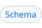
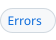
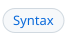

<!-- header # workflow "`mod :: dsys/workflow`" |Syntax #syntax | Reduction #reduction | API #api | Errors #errors | Demos #demos | Refs #references | Schema #schema -->
<h1><a id="workflow"></a><a href="dsys.md"><picture><source media="(prefers-color-scheme: dark)" srcset="img/hdr/docs-workflow.workflow.up.dark.svg"></picture></a><a href="../README.md#module-index"><picture><source media="(prefers-color-scheme: dark)" srcset="img/hdr/docs-workflow.workflow.mod.dark.svg"></picture></a><picture><source media="(prefers-color-scheme: dark)" srcset="img/hdr/docs-workflow.workflow.title.dark.svg"></picture><a href="#schema"><picture><source media="(prefers-color-scheme: dark)" srcset="img/hdr/docs-workflow.workflow.6.dark.svg"></picture></a><a href="#references"><picture><source media="(prefers-color-scheme: dark)" srcset="img/hdr/docs-workflow.workflow.5.dark.svg"></picture></a><a href="#demos"><picture><source media="(prefers-color-scheme: dark)" srcset="img/hdr/docs-workflow.workflow.4.dark.svg"></picture></a><a href="#errors"><picture><source media="(prefers-color-scheme: dark)" srcset="img/hdr/docs-workflow.workflow.3.dark.svg"></picture></a><a href="#api"><picture><source media="(prefers-color-scheme: dark)" srcset="img/hdr/docs-workflow.workflow.2.dark.svg"></picture></a><a href="#reduction"><picture><source media="(prefers-color-scheme: dark)" srcset="img/hdr/docs-workflow.workflow.1.dark.svg"></picture></a><a href="#syntax"><picture><source media="(prefers-color-scheme: dark)" srcset="img/hdr/docs-workflow.workflow.0.dark.svg"></picture></a><br clear="all"></h1>
<!-- /header -->

<a id="overview"></a>

Part of the [dsys toolkit](dsys.md), the `@workflow.dag` syntax declares a task graph as data and compiles it to a [Petri net](petri.md):

```Makefile
load dsys/workflow

@workflow.dag
define release
  {"tasks": {"build": {"run": "build"}, "ship": {"run": "ship", "needs": ["build"]}}}
endef

build ship:
	@echo $@

__main__: release.__main__
```

* each task runs a target, in any [guest engine](FFI.md),
* `needs` orders tasks partially, and `when` picks which outcomes of the needs let a task run,
* `over` fans one task out across a list of items, and
* `pool` bounds how many firings of a task hold a [pool](pool.md) token at once.

The compiled net is an ordinary net: `<name>.__main__` and every other [petri call](petri.md#api) work on it.

<a id="make"></a>

A Makefile is a task graph too. A workflow differs from `target: prereqs` in four ways:

| # | Make | Workflow |
| --- | --- | --- |
| 1 | The order lives on each target, as its prerequisite list | The order lives in one body, apart from the targets it runs, so a target serves many workflows unchanged |
| 2 | A failed prerequisite stops the build, unless `-k` keeps going | A failure is an outcome, passed on as a label; `when` routes on it, and a skipped task passes its skip on |
| 3 | A target is built once per run | `over` runs one task once per item, and `pool` bounds those runs |
| 4 | Prerequisites are a partial order | `needs` is a partial order: two tasks with no path of needs between them are unordered |

<a id="syntax"></a>

## Syntax

| Form | Declares |
| --- | --- |
| `@workflow.dag` above a define | A workflow of the define's name, compiled to a net of the same name, `<name>.__main__` its target |
| `$(workflow.compile name)` | The compiled net's JSON, without loading it |

A workflow is an object with one key, `tasks`, mapping each task name to its keys. A task name is `[a-z0-9_-]+`.

| Key | Value | Default |
| --- | --- | --- |
| `run` | The target the task runs | No step |
| `needs` | Task names that end before this one starts; the only order between tasks | `[]` |
| `when` | `success`, `failed` or `done`: whether the task runs when all needs succeeded, when any failed, or always | `success` |
| `over` | `{"data": [..]}` or `{"targets": [..]}`, each item 1 to 31 bytes with no whitespace; the task runs once per item | Runs once |
| `pool` | A pool name; each firing holds one of its tokens | unbounded |

A task whose `when` does not hold is skipped, and its skip passes on as its outcome.

Each instance of a task with `over` reads its item as `<run>.item`, under the name of the
target it runs. Under `data` the item is the label. Under `targets` the item is the value of
the target that the label names:

```Makefile
@workflow.dag
define ingest
  { "tasks": { "square": { "run": "each", "over": { "targets": ["b1", "b2"] } } } }
endef

b1:
	@echo 1 2 3
b2:
	@echo 4 5 6
each:
	@echo 'squaring $(each.item)'
```

Every task is a target too, as in make: `<name>.<task>` runs the task and every task it
needs, transitively, and nothing after it. In the [release demo](../demos/workflow-release.amk),
`release.package` runs checkout, the three tests and package, but not publish or notify.

Tasks with no `needs` path between them run at once, each firing of a task as a job. The
[job pool](jobman.md) bounds how many are in flight, `AMK_MAX_JOBS` at once, and `pool`
bounds one task. `AMK_MAX_JOBS=1`, or every task naming one pool of size 1, runs the
workflow one task at a time:

```Makefile
$(amk.pool one, 1)
```

<a id="reduction"></a>

## Reduction

`workflow.jq` compiles the JSON once, at parse, and hands the net to `petri.load`:

| Task part | Becomes |
| --- | --- |
| A need | A labeled place `<need>.to.<task>`, its token the need's outcome |
| A task with no needs | A place `<task>.ready` holding one `success` token |
| The task | A transition guarded by `when`, its step of kind [`agoal.maybe`](petri.md#amk-block), run as a job, its outcome the token's label |
| `when` other than `done` | A second transition `<task>.skip` guarded by the opposite |
| `over` | Transitions `<task>.split` and `<task>.join` around places `<task>.items` and `<task>.results`, the step binding `<run>.item` |
| A task's name | A second net `<name>.<task>.cone`, the workflow cut to the task and its needs, and a phony target `<name>.<task>` that runs it |
| `pool` | An arc from the pool into the task and back |
| A task nothing needs | A place `<task>.end`; the final marking wants one token in each |

<a id="api"></a>

## API

| Call | Does | Answers |
| --- | --- | --- |
| `<name>.__main__` | Runs the workflow as its net; typically `__main__: <name>.__main__` | A target |
| `$(<name>.net )` | Reads back the compiled net | The net's JSON |
| `$(<name>.states )`, `$(<name>.trace)`, `$(<name>.step )` | As for [any net](petri.md#api) | words |
| `$(<name>.exec prog)` | A jq program over the net, the workflow's JSON as `$source` and the library as `workflow::` | What it prints |
| `$(<name>.version )` | The workflow's workspace version | A number |

`workflow.dag` is a [stacked engine](FFI.md#stacked-engines) on jq, aliased `workflow`, so `@workflow.dag.target`,
`@workflow.dag.import` and `@workflow.dag.exec (name)` are its at lines and [`load ./release.workflow`](petri.md#loading)
reads a file as a workflow.

<a id="errors"></a>

## Errors

A body that fails the [schema](#schema) is refused first, with every error it has, as in
`release: does not meet schema/workflow.json: Property tasks: Additional property a: Property when: Value "always" not in enum; ...`.
That covers the keys, the task names, `when` and `over`. The compiler then refuses what a
schema cannot say, before any net exists:

| Condition | Message |
| --- | --- |
| A need that is no task | `t: needs n, which is no task` |
| A cycle in `needs` | `t: is on a cycle in needs` |

The `workflow.compile` function runs the compiler alone, without the schema, so a malformed
body given to it directly fails as a jq error.

<a id="demos"></a>

## Demos

| Demo | Shows |
| --- | --- |
| [`workflow-release.amk`](../demos/workflow-release.amk) | A release graph with a fan-out over guests, a pool of runners, and a task run only on failure |
| [`workflow-instances.amk`](../demos/workflow-instances.amk) | One child workflow instance per batch target, each running a body on the plex |

<a id="references"></a>

## References

- [Petri nets](petri.md), what a workflow compiles to.
- [Kahn networks](kahn.md), the other form that compiles to a net.
- [dsys](dsys.md), the topic this module is a part of.

<a id="schema"></a>

## Schema

The full form, as a JSON Schema, is [`schema/workflow.json`](../payload/lib/dsys/schema/workflow.json),
and every `@workflow.dag` body is checked against it before it compiles. A workflow is also refused for
what a schema cannot say, as [errors](#errors) lists: a need that names no task, or needs that form a cycle.

```json
{
  "$schema": "https://json-schema.org/draft/2020-12/schema",
  "$id": "workflow.json",
  "title": "@workflow.dag",
  "description": "a task graph under @workflow.dag, compiled by workflow.jq to a net; that each need names a task, and that needs hold no cycle, are checked by the compile",
  "type": "object",
  "additionalProperties": false,
  "required": ["tasks"],
  "$defs": {
    "labels": {
      "type": "array",
      "minItems": 1,
      "items": { "type": "string", "pattern": "^\\S{1,31}$" }
    }
  },
  "properties": {
    "tasks": {
      "description": "each task by name, in declaration order",
      "type": "object",
      "minProperties": 1,
      "propertyNames": { "pattern": "^[a-z0-9_-]+$" },
      "additionalProperties": {
        "type": "object",
        "additionalProperties": false,
        "properties": {
          "run": { "description": "the target the task runs; without it, the task only passes its outcome on", "type": "string", "minLength": 1 },
          "needs": {
            "description": "the tasks that must end before this one starts",
            "type": "array",
            "items": { "type": "string" },
            "default": []
          },
          "when": {
            "description": "which outcomes of its needs let it run: success when all succeeded, failed when any failed, done either way; otherwise it is skipped",
            "enum": ["success", "failed", "done"],
            "default": "success"
          },
          "over": {
            "description": "what the task runs once per: data, each item a label, or targets, each item the value of the target it names",
            "type": "object",
            "minProperties": 1,
            "maxProperties": 1,
            "additionalProperties": false,
            "properties": {
              "data": { "$ref": "#/$defs/labels" },
              "targets": { "$ref": "#/$defs/labels" }
            }
          },
          "pool": { "description": "an open pool whose tokens bound the task's runs in flight", "type": "string", "minLength": 1 }
        }
      }
    }
  }
}
```
